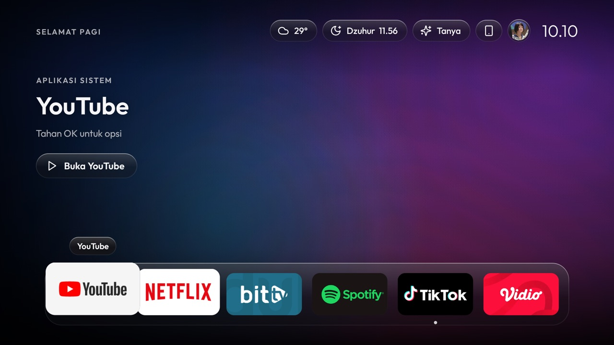
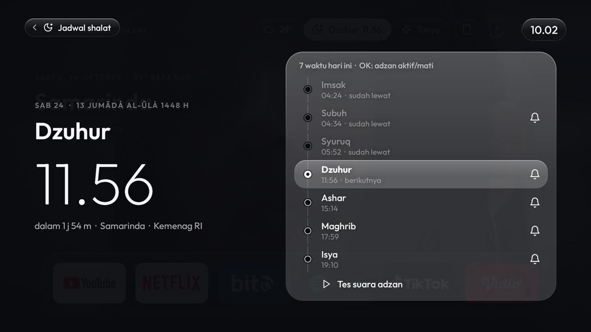
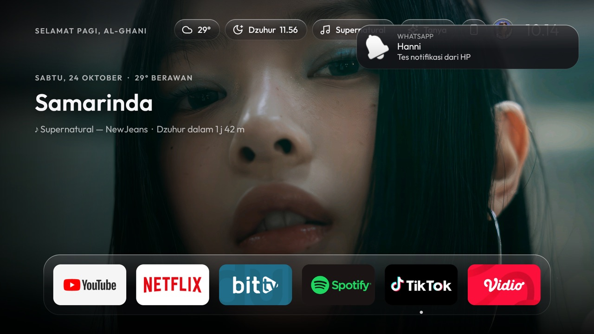
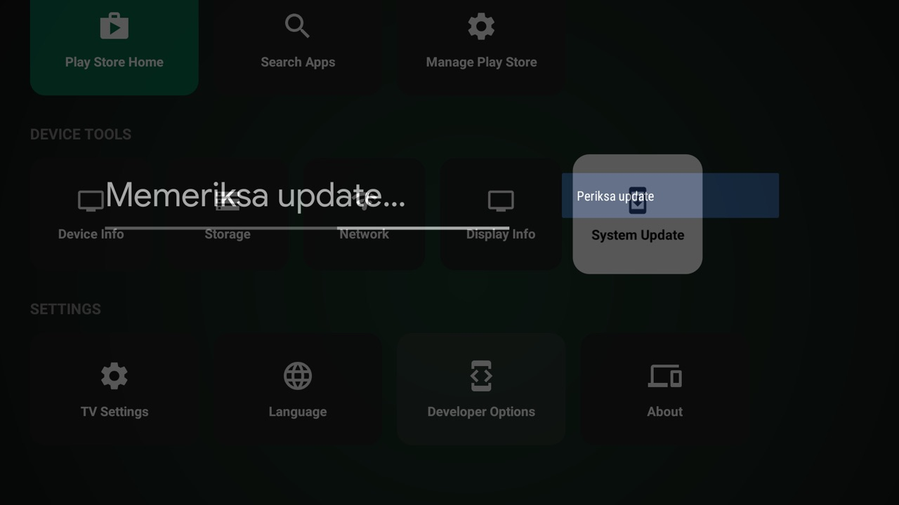
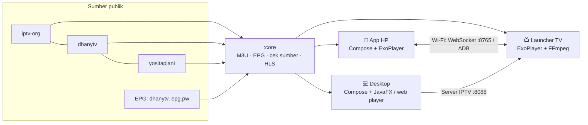

<a href="README.md">English</a> · <b>Bahasa Indonesia</b> · <a href="README.zh.md">中文</a>

<h1 align="center">Tahoe TV</h1>

  <b>Tahoe TV: TV yang tenang dan mudah, untuk seisi rumah. 
  Beranda Android TV bergaya kaca yang gratis dan open source, lengkap dengan Live TV gratis, 
  plus app pendamping untuk HP Android, macOS, Windows, dan Linux Debian/Ubuntu.</b> 
  Ringan untuk TV murah: dibuat dan diuji di <b>Xiaomi Mi TV Stick (Android 9, RAM 1 GB)</b>.

  
  
  
  
  
  
  

  <a href="https://github.com/fk0u/cleanyourtv-tahoe/releases/latest"><b>⬇️ Unduh</b></a> ·
  <a href="https://tahoe.kousozo.tech/?lang=id">🌐 Situs web</a> ·
  <a href="#mulai-dalam-5-menit">Mulai</a> ·
  <a href="#fitur">Fitur</a> ·
  <a href="#screenshot">Screenshot</a> ·
  <a href="docs/id/ROADMAP.md">Roadmap</a> ·
  <a href="docs/id/CONTRIBUTING.md">Kontribusi</a>

> [!NOTE]
> **Tahoe TV adalah proyek open source komunitas untuk seluruh dunia.** Berlisensi MIT: bebas dipakai, dipelajari,
> dikonfigurasi, di-fork, dan dirilis ulang versimu sendiri — dan pull request terbuka untuk siapa pun, dari mana pun,
> dalam bahasa apa pun. Lahir di Indonesia, kini berbahasa English, Bahasa Indonesia, dan 中文, dengan saluran gratis
> dari semua negara ([#71](https://github.com/fk0u/cleanyourtv-tahoe/issues/71)). Mau negara atau bahasamu masuk? [Ayo ikut](#ikut-berkontribusi).

## Asal-usul proyek ini

Tahoe TV lahir dari kegabutan pemiliknya — dan dari rasa kesal yang nyata. Launcher bawaan TV di rumah membosankan,
penuh iklan, dan susah dipakai, dan yang paling kesulitan justru anggota keluarga yang sudah lansia: tulisannya kecil,
menunya membingungkan, dan TV siaran malah tersembunyi di balik aplikasi, bukan *nyalakan lalu ganti saluran* seperti biasa.

Jadi tujuannya sederhana: **beranda TV yang cantik, tenang, dan mudah untuk semua orang — termasuk kakek-nenek**,
dengan Live TV yang terasa seperti TV biasa (▲ ▼ untuk ganti saluran, jelas "sedang tayang apa"), ringan di TV stick
1 GB yang murah, dan gratis untuk dipakai serta dikembangkan siapa pun di dunia.

---

## Kenapa Tahoe TV?

- 📺 **Beranda TV yang cantik dan ringan.** Gaya kaca yang tenang tanpa blur berat, jadi tetap lancar di TV stick 1 GB.
- 👵 **Mudah untuk semua orang.** Tile besar yang mudah dibaca, navigasi satu langkah dengan remote, dan Live TV seperti TV biasa: ▲ ▼ ganti saluran, jadwal menampilkan acara yang sedang tayang. (Nomor saluran yang konsisten untuk tiap negara menyusul.)
- 🗣️ **Bahasamu duluan.** Setup awal di TV, HP, dan desktop dimulai dari bahasa (English, Bahasa Indonesia, 中文), lalu negara, kota, jadwal shalat, saluran, dan favorit.
- 🌍 **Live TV gratis.** 1.000+ saluran gratis (Indonesia dulu: nasional, TVRI daerah, TV lokal "dekat kamu", berita, olahraga…) dengan jadwal acara, dari sumber publik. Berikutnya semua negara ([#71](https://github.com/fk0u/cleanyourtv-tahoe/issues/71)).
- ⚡ **Langsung tayang.** Sumber yang hidup diputar duluan; siaran ulang dan sumber mati dilewati otomatis. Pilih kualitas (Otomatis/1080p/720p/480p) dan latensi.
- 📱 **HP jadi remote dan pusat kendali.** Remote lengkap, ketik ke TV, kirim foto, nonton di HP, pasang Tahoe ke TV lewat Wi-Fi tanpa laptop.
- 💻 **App desktop (macOS, Windows & Linux).** Live TV, rekam acara (DVR), server IPTV untuk seluruh rumah, serta remote + cermin layar TV.
- 👨‍👩‍👧 **Profil keluarga.** Saya, Tamu, dan **Anak** (dikunci PIN, hanya saluran anak).
- 🕌 **Jadwal shalat & adzan**, cuaca, asisten Gemini, Home Assistant.
- 🔓 **Gratis, open source (MIT), tanpa iklan, tanpa root.**

## Mulai dalam 5 menit

| Saya punya… | Unduh | Lalu |
|---|---|---|
| **Android TV / TV box** (Mi TV Stick, Chromecast, dll.) | [`tahoe-tv.apk`](https://github.com/fk0u/cleanyourtv-tahoe/releases/latest/download/tahoe-tv.apk) di HP Android | Buka app HP → **Pasang** → pilih TV di Wi-Fi yang sama. Launcher terpasang otomatis ([langkah lengkap](docs/id/INSTALL.md#pasang-dari-hp-tanpa-laptop)) |
| **HP Android** saja | [`tahoe-tv.apk`](https://github.com/fk0u/cleanyourtv-tahoe/releases/latest/download/tahoe-tv.apk) | Nonton Live TV di HP, atau jadi remote TV |
| **Mac** (Apple Silicon / Intel) | [`TahoeTV-macos-arm64.dmg`](https://github.com/fk0u/cleanyourtv-tahoe/releases/latest/download/TahoeTV-macos-arm64.dmg) · [`TahoeTV-macos-intel.dmg`](https://github.com/fk0u/cleanyourtv-tahoe/releases/latest/download/TahoeTV-macos-intel.dmg) | Buka → TV Live. Pertama kali: klik kanan → **Buka** (app belum dinotarisasi) |
| **Windows 10/11** | [`TahoeTV-windows.msi`](https://github.com/fk0u/cleanyourtv-tahoe/releases/latest/download/TahoeTV-windows.msi) | Pasang → TV Live |
| **Debian / Ubuntu** (64-bit) | [`TahoeTV-linux-amd64.deb`](https://github.com/fk0u/cleanyourtv-tahoe/releases/latest/download/TahoeTV-linux-amd64.deb) | `sudo apt install ./TahoeTV-linux-amd64.deb` → TV Live |
| Sudah ada launcher, mau pasang manual | [`tahoe-launcher.apk`](https://github.com/fk0u/cleanyourtv-tahoe/releases/latest/download/tahoe-launcher.apk) | Lihat [docs/id/INSTALL.md](docs/id/INSTALL.md) |

Pembaruan diperiksa otomatis: TV, HP, dan desktop memeriksa rilis GitHub (Pusat Kontrol → **Tentang**) untuk kamu unduh dan pasang.

## Screenshot

**Di TV**

**Di HP**

Screenshot lainnya (ukuran penuh)

| Beranda | **Jadwal shalat & adzan** |
|---|---|
|  |  |
| **Notifikasi & musik dari HP** | **Hubungkan HP (QR + kode)** |
|  |  |

## Fitur

### 📺 TV (launcher Android TV)
- **Tampilan tenang dan sinematik:** material kaca dengan efek lift dan kilau, dock mengambang, Launchpad dengan rak Game, hero editorial (trending YouTube, populer di Netflix), dan transisi buka aplikasi.
- **Profil:** Saya, Tamu, dan **Anak**. Profil Anak dikunci PIN 4 angka, hanya menampilkan saluran Anak & Dokumenter dan aplikasi yang diizinkan. PIN bisa diatur ulang dari HP yang sudah dipasangkan.
- **Live TV:** saluran per kategori, jadwal acara, favorit dan terakhir ditonton, nomor saluran, tunda/maju 30 detik, loading layar penuh yang tenang, serta pilihan kualitas + latensi.
- **Pintar memilih sumber:** sumber hidup diputar duluan; siaran rekaman/basi dilewati; tahan **OK** untuk menandai sumber "bukan live". Dekoder cadangan + **FFmpeg** untuk audio AC-3/E-AC-3/DTS/MP2.
- **Pusat Kontrol:** volume, musik dari HP, Wi-Fi, Bluetooth, wallpaper, cuaca, shalat, asisten, rumah, timer tidur, **Kirim log**, dan pembaruan.
- **Jadwal shalat & adzan** (Kemenag RI lewat Aladhan), **cuaca** per jam/7 hari (Open-Meteo), **asisten Gemini**, **Home Assistant**, **gamepad**, dan **screensaver** hemat energi.

### 📱 HP (Android)
- **Pasang Tahoe ke TV lewat Wi-Fi** (ADB) tanpa laptop: debloat, nama, kota, dock, API key, pulihkan TV.
- **Remote lengkap:** D-pad/swipe, slider volume, CH, nomor saluran, media, power, timer tidur, ketik ke TV, tanya asisten.
- **Live TV di HP** dengan mini player, halaman saluran, favorit, pencarian, serta setelan kualitas dan latensi.
- **Pairing lewat QR** dari layar TV, **notifikasi & musik HP di TV**, **Kirim log**, dan **atur ulang PIN Anak**.

### 💻 Desktop (macOS 13+ & Windows 10/11)
- **TV Live** dengan status LIVE/OFFLINE per saluran, kategori, dan pencarian nama/acara. Di Windows diputar di jendela Edge yang ringan.
- **Rekam acara (DVR)** dari jadwal, file di `~/Movies/Tahoe TV`, bisa ditonton dari TV/HP lewat LAN.
- **Server IPTV LAN:** `http://<ip>:8088/playlist.m3u` dan `/epg.xml` untuk TV, HP, VLC, Kodi, TiviMate, plus relay header.
- **TV Rumah:** temukan Android TV di Wi-Fi, pasang dan atur Tahoe, **remote + cermin layar** lewat ADB.

## Bagaimana cara kerjanya

Semua logika bersama (playlist, EPG, pengecekan sumber, perekam HLS, log diagnostik) ada di modul `:core` dan dipakai
ketiga aplikasi. Detail: [docs/id/ARCHITECTURE.md](docs/id/ARCHITECTURE.md).

## Dokumentasi

| Dokumen | Bahasa Indonesia | English |
|---|---|---|
| Instalasi & konfigurasi | [INSTALL.md](docs/id/INSTALL.md) | [INSTALL.md](docs/INSTALL.md) |
| Arsitektur | [ARCHITECTURE.md](docs/id/ARCHITECTURE.md) | [ARCHITECTURE.md](docs/ARCHITECTURE.md) |
| Roadmap | [ROADMAP.md](docs/id/ROADMAP.md) | [ROADMAP.md](docs/ROADMAP.md) |
| Berkontribusi | [CONTRIBUTING.md](docs/id/CONTRIBUTING.md) | [CONTRIBUTING.md](CONTRIBUTING.md) |
| Keamanan | [SECURITY.md](SECURITY.md#bahasa-indonesia) | [SECURITY.md](SECURITY.md) |
| Kode etik | [CODE_OF_CONDUCT.md](CODE_OF_CONDUCT.md#bahasa-indonesia) | [CODE_OF_CONDUCT.md](CODE_OF_CONDUCT.md) |
| Catatan rilis | [CHANGELOG.md](CHANGELOG.md) | |
| Brand | [BRAND.md](docs/brand/BRAND.md) | |

Mau menerjemahkan dokumen ke bahasamu? Taruh di `docs/<kode-bahasa>/` dan tautkan di sini.

## Batasan

- **Tanpa root:** Assistant, popup volume, dan Settings sistem tidak bisa diganti; tombol tidak bisa disuntik ke aplikasi lain (Back/Home tetap bisa).
- **Notifikasi dari TV sendiri** diblokir firmware low-RAM. Solusinya app HP.
- **Saluran berbayar/DRM tidak diputar** di TV dan HP; Tahoe hanya memakai siaran gratis dari sumber publik dan tidak meng-host siaran apa pun.
- **Google TV dan webOS** belum didukung penuh: lihat [#40](https://github.com/fk0u/cleanyourtv-tahoe/issues/40) dan [#26](https://github.com/fk0u/cleanyourtv-tahoe/issues/26).

## Ikut berkontribusi

Tahoe TV **gratis dan terbuka untuk semua orang di seluruh dunia**: fork, konfigurasi untuk negara atau keluargamu,
rilis versimu sendiri dengan lisensi MIT, atau kirim perbaikanmu kembali ke sini. Pull request terbuka untuk siapa
pun — issue dan PR dalam English, Bahasa Indonesia, atau 中文 semuanya boleh. Bantuan apa pun berarti:

- ⭐ **Beri bintang** repo ini kalau Tahoe TV berguna. Itu membantu orang lain menemukannya.
- 🌍 **Terjemahkan** app atau dokumentasi, atau **tambahkan saluran negaramu** ([#71](https://github.com/fk0u/cleanyourtv-tahoe/issues/71), [#56](https://github.com/fk0u/cleanyourtv-tahoe/issues/56)).
- 🐞 **Lapor bug:** pakai **Kirim log** di app, lalu buka [issue baru](https://github.com/fk0u/cleanyourtv-tahoe/issues/new/choose).
- 💡 **Ambil issue:** [`good first issue`](https://github.com/fk0u/cleanyourtv-tahoe/labels/good%20first%20issue) · [`help wanted`](https://github.com/fk0u/cleanyourtv-tahoe/labels/help%20wanted).
- 💬 **Tanya atau diskusi** di [Discussions](https://github.com/fk0u/cleanyourtv-tahoe/discussions).
- 📣 **Bagikan** ke grup Android TV, STB, atau komunitas IPTV.

Mulai dari [docs/id/CONTRIBUTING.md](docs/id/CONTRIBUTING.md). Celah keamanan lewat [SECURITY.md](SECURITY.md#bahasa-indonesia), jangan lewat issue publik.

### Kontributor

Terima kasih untuk semua yang sudah ikut membangun Tahoe TV:

## Kredit & lisensi

- Kode: [MIT](LICENSE) © Al-Ghani ([@fk0u](https://github.com/fk0u)) dan para kontributor.
- Ikon [Lucide](https://lucide.dev) (ISC). Font [Outfit](https://github.com/Outfitio/Outfit-Fonts) (SIL OFL 1.1).
- Pemutar: [Media3/ExoPlayer](https://github.com/androidx/media) (Apache 2.0), dekoder FFmpeg dari [Jellyfin media3-ffmpeg-decoder](https://github.com/jellyfin/jellyfin-androidx-media) (FFmpeg: LGPL 2.1+), [hls.js](https://github.com/video-dev/hls.js) (Apache 2.0). Server HP: [NanoHTTPD](https://github.com/NanoHttpd/nanohttpd). ADB: [dadb](https://github.com/mobile-dev-inc/dadb). QR: [ZXing](https://github.com/zxing/zxing).
- Saluran & jadwal TV: [iptv-org](https://github.com/iptv-org/iptv), [yositapjani/iptv-indonesia](https://github.com/yositapjani/iptv-indonesia), [dhanytv](https://github.com/dhasap/dhanytv) oleh @dhasap (hanya bagian TV gratis Indonesia), [epg.pw](https://epg.pw). Tahoe tidak meng-host siaran apa pun.
- Data: [Open-Meteo](https://open-meteo.com/) · [Aladhan](https://aladhan.com/prayer-times-api) · [TMDB](https://www.themoviedb.org/) (produk ini tidak didukung atau disertifikasi TMDB) · YouTube Data API · Gemini API.
- Terinspirasi dari [cleanyourtv](https://github.com/Gathin23/cleanyourtv). Proyek open source independen; bukan produk Apple dan tidak berafiliasi dengan Apple Inc.
