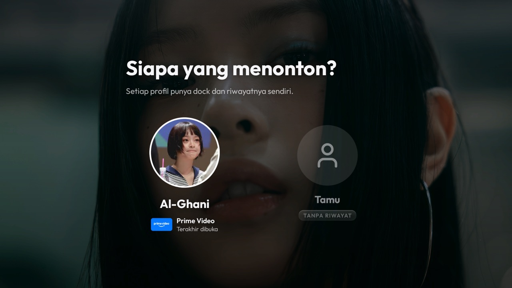
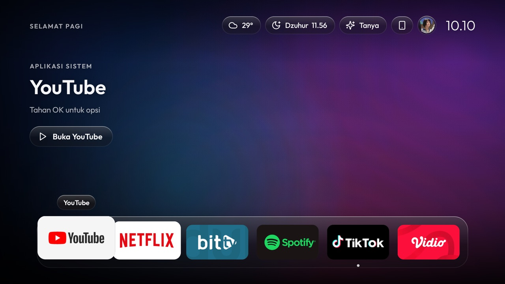
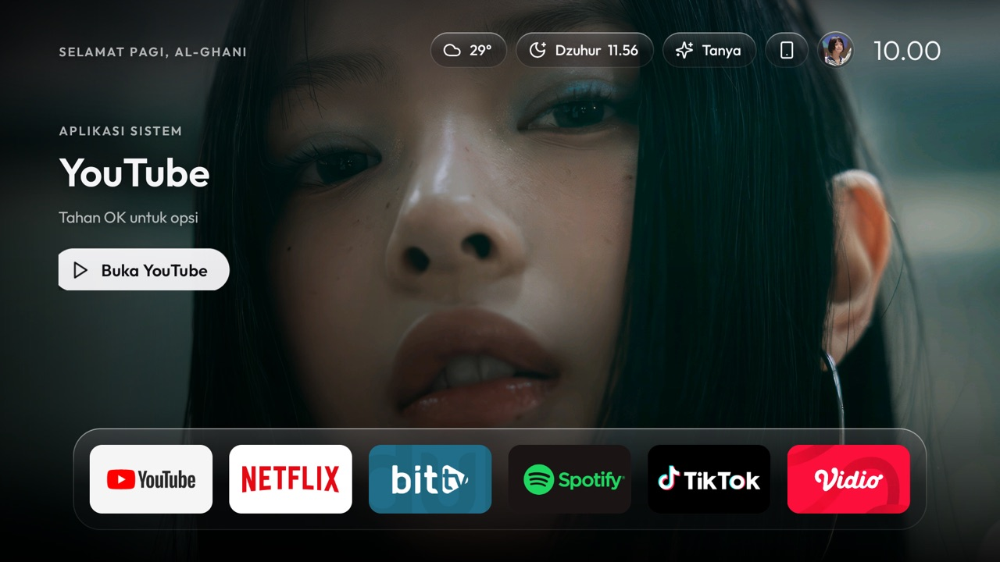
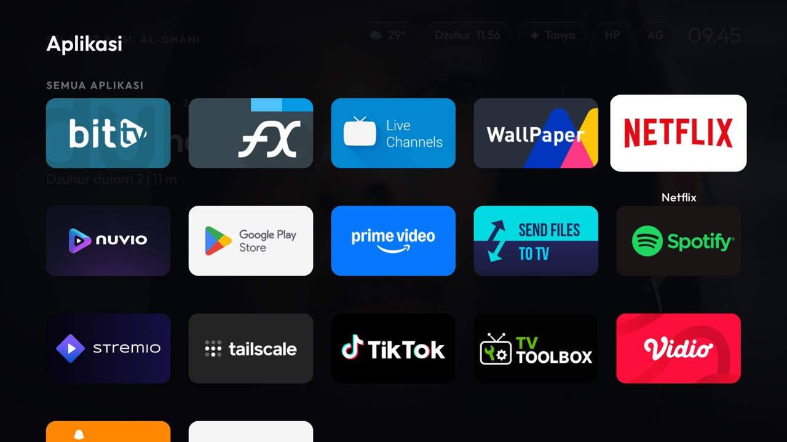
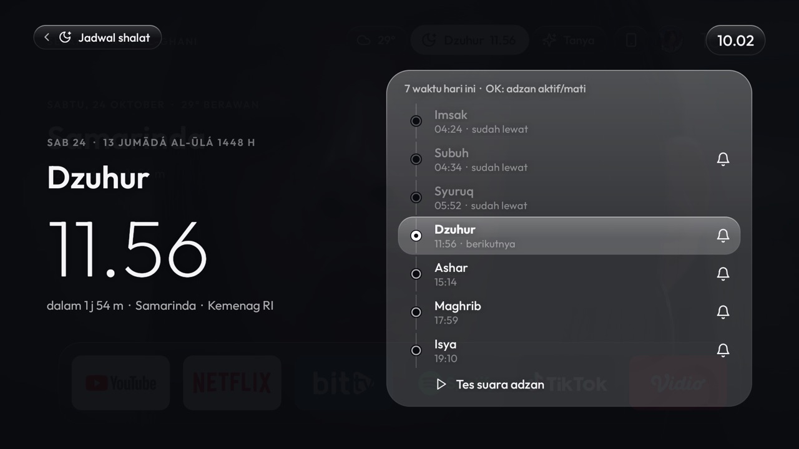
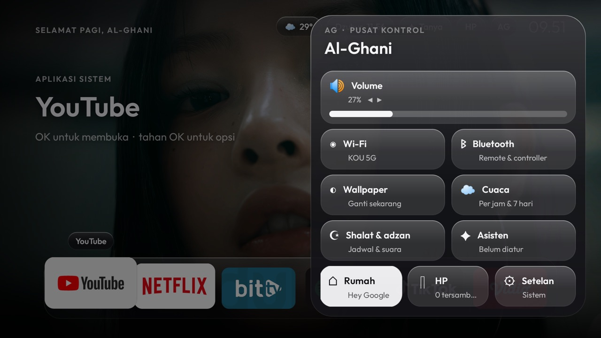
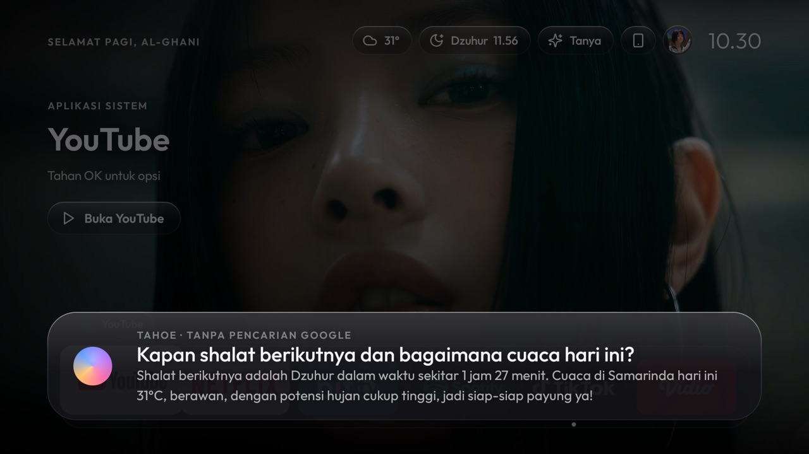
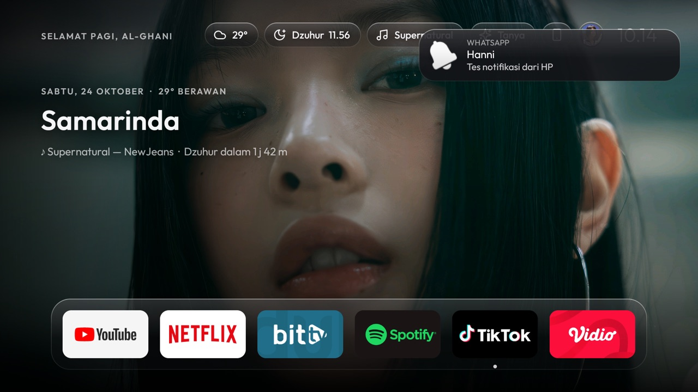
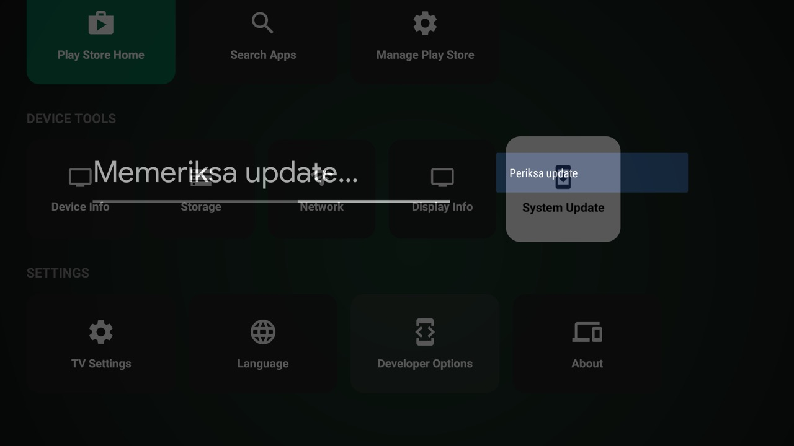
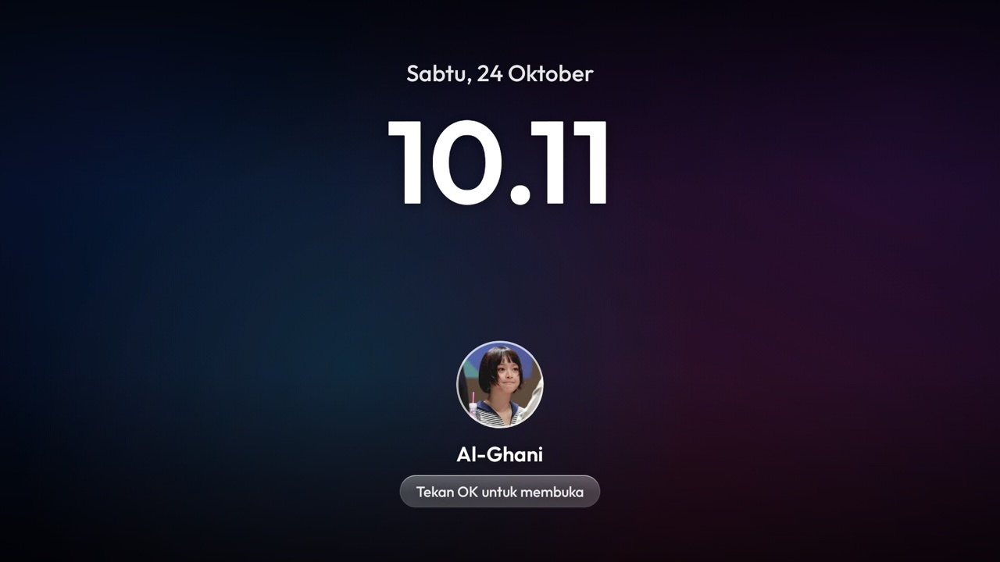

<p align="center"></p>

<p align="center">
  <b>Launcher ala tvOS 26 (Liquid Glass) + debloat untuk Android TV</b><br>
  Dibuat dan diuji di <b>Xiaomi Mi TV Stick (MiTV-AESP0, Android 9, 1 GB RAM)</b>.
</p>

<p align="center">
  
  
  
  
  
</p>

> Roadmap & status per fitur: [PLAN.md](PLAN.md) · [issues](https://github.com/fk0u/cleanyourtv-tahoe/issues?q=label%3Aroadmap)

## Daftar isi
[Screenshot](#screenshot) · [Fitur](#fitur) · [Kontrol](#kontrol) · [Instalasi](#instalasi) · [Konfigurasi](#konfigurasi) ·
[API key](#api-key-opsional) · [HP ↔ TV](#hp--tv) · [Wallpaper & foto](#wallpaper--foto) · [Debloat](#debloat) ·
[Batasan perangkat](#batasan-perangkat) · [Mengembalikan semuanya](#mengembalikan-semuanya) · [Struktur proyek](#struktur-proyek) · [Kredit](#kredit--lisensi)

## Screenshot

| Siapa yang menonton? | Beranda (profil Tamu, wallpaper default) |
|---|---|
|  |  |
| **Hero + tombol aksi** | **Launchpad** |
|  |  |
| **Jadwal shalat & adzan** | **Pusat Kontrol** |
|  |  |
| **Asisten (Gemini)** | **Notifikasi & musik dari HP** |
|  |  |
| **Hubungkan HP (QR + kode)** | **Screensaver hemat energi** |
|  |  |

> Wallpaper NewJeans di sebagian screenshot adalah foto pribadi pemilik perangkat dan **tidak** ada di repo ini.

## Fitur

**Tampilan (Apple HIG, tvOS 26)**
- UI digambar sendiri, tanpa widget bawaan: material kaca (`GlassDrawable`), tile dengan efek lift dan kilau, skala tipografi tvOS, dan safe area 60/80 px.
- Ikon **Lucide** (SVG → VectorDrawable lewat `tools/lucide.py`), tanpa emoji.
- **Siapa yang menonton?** saat boot: profil pemilik (foto, aplikasi terakhir dibuka) dan **Tamu**. Tiap profil punya dock sendiri.
- **Hero editorial full-bleed**: tanggal, cuaca, dan shalat berikutnya. Saat aplikasi difokus muncul tombol aksi ("Buka YouTube").
  - **YouTube**: thumbnail trending Indonesia (butuh `youtube.apiKey`).
  - **Netflix**: "Populer di Netflix" dari TMDB (butuh `tmdb.apiKey`).
  - Gambar kontekstual bergerak pelan (Ken Burns).
- **Dock ala macOS** (default 6 aplikasi): magnifikasi tetangga, tooltip, dan titik "baru dipakai".
- **Transisi buka aplikasi**: tile membesar ke layar penuh dengan warna aplikasinya.
- **Launchpad**: rak **Game** (Moonlight, Steam Link, Chiaki-ng/PS Remote Play, GeForce NOW) dan semua aplikasi.
- **Pusat Kontrol**: volume, musik dari HP, Wi-Fi, Bluetooth, wallpaper (Pribadi/Default), cuaca, shalat, asisten, rumah, HP, dan setelan.

**Fitur hidup**
- **Cuaca interaktif** (Open-Meteo, tanpa key): pilih jam, prakiraan per jam dan 7 hari, langit beranimasi ringan.
- **Jadwal shalat** (Aladhan, metode Kemenag RI): Imsak–Isya, tanggal Hijriah, timeline, dan **adzan** per waktu dengan `AlarmManager` (tahan reboot), plus banner di atas aplikasi apa pun.
- **Asisten suara Gemini**: mic TV atau ketik/dikte dari HP. Tools untuk buka aplikasi, cari di YouTube, cuaca, shalat, volume, wallpaper, dan rumah. Memakai **Google Search grounding** bila kuota tersedia.
- **Rumah**: Home Assistant (REST lokal), atau "Hey Google" lewat tombol mic remote.
- **Gamepad**: controller Bluetooth (stik, A/B/X/Y, L1/R1, Start/Select) **atau HP sebagai gamepad**.
- **Screensaver hemat energi**: layar diredupkan, slideshow pelan, jam besar, dan foto profil. Tekan OK untuk membuka.

## Kontrol

| Tombol (remote / gamepad) | Aksi |
|---|---|
| ◀ ▶ ▲ ▼ / stik | Pindah tepat satu langkah. Urutan baris: top bar → tombol hero → dock → Launchpad |
| OK / A | Buka · pilih |
| Tahan OK / X | Menu aplikasi: sematkan/lepas, geser posisi, info, uninstall |
| Back / B | Tutup panel → kembali ke dock |
| Apps / Start | Launchpad |
| Menu / Y | Pusat Kontrol |
| Select | Asisten |
| L1 / R1 | Lompat 3 baris di Launchpad |

## Instalasi

Butuh: Python 3, JDK 17, Android SDK (platform 36, build-tools 34+). Gradle diunduh otomatis oleh wrapper.
Di TV: **Settings → Device Preferences → About → tekan "Build" 7×**, lalu **Developer options → USB debugging: ON**.

```bash
git clone https://github.com/fk0u/cleanyourtv-tahoe.git && cd cleanyourtv-tahoe
python3 -m venv .venv && .venv/bin/pip install -r requirements.txt
cp secrets.example.properties secrets.properties     # opsional: isi API key
export TV_HOST=192.168.1.50                           # IP TV kamu
./build-and-install.sh                                # build APK (Gradle) + pasang
```

Izin satu kali:
```bash
T=".venv/bin/python tools/tv.py"
$T 'pm grant tv.clean.home android.permission.ACCESS_FINE_LOCATION'    # nama Wi-Fi
$T 'pm grant tv.clean.home android.permission.WRITE_SECURE_SETTINGS'   # tombol Apps tetap aktif setelah reboot
$T 'pm grant tv.clean.home android.permission.RECORD_AUDIO'            # mic untuk asisten
$T 'appops set tv.clean.home SYSTEM_ALERT_WINDOW allow'                # banner shalat & notifikasi HP
$T 'appops set tv.clean.home GET_USAGE_STATS allow'                    # titik "baru dipakai", aplikasi terakhir
$T 'cmd package set-home-activity tv.clean.home/.Home'
$T 'settings put secure screensaver_components tv.clean.home/tv.clean.home.Lock'
tools/disable.sh com.google.android.tvlauncher                         # matikan launcher bawaan (bisa dikembalikan)
```

## Konfigurasi

[`launcher/src/main/res/values/config.xml`](launcher/src/main/res/values/config.xml), lalu `./build-and-install.sh`:

| Kunci | Default | Fungsi |
|---|---|---|
| `dock_size` | `6` | Slot dock (4–7) |
| `columns` | `5` | Kolom Launchpad |
| `dock_apps` | YouTube, Netflix, BitTV, Spotify, TikTok, Vidio | Isi dock awal (nama paket). Yang tidak terpasang dilewati |
| `user_name` | `Al-Ghani` | Nama di sapaan, profil, dan layar kunci |
| `avatar_url` | foto GitHub | Foto profil (di-cache di TV) |
| `city`, `latitude`, `longitude` | Samarinda | Cuaca & jadwal shalat |
| `wallpaper_minutes` | `10` | Interval ganti wallpaper |

Susunan dock yang diubah lewat menu tahan-OK disimpan di TV per profil.

## API key (opsional)

Isi di `secrets.properties` (gitignored, tidak pernah ikut ke repo). Kosong = fitur disembunyikan.

| Kunci | Untuk | Dapatkan di |
|---|---|---|
| `gemini.apiKey`, `gemini.model` | Asisten (default `gemini-3.5-flash-lite`) | [Google AI Studio](https://aistudio.google.com/apikey) |
| `youtube.apiKey` | Hero "Trending di YouTube" | Google Cloud → YouTube Data API v3 |
| `tmdb.apiKey` | Hero "Populer di Netflix" | [TMDB](https://www.themoviedb.org/settings/api) |
| `homeassistant.url`, `homeassistant.token` | Panel Rumah | Home Assistant → Profil → Long-lived token |

Catatan Gemini: pencarian Google (grounding) memakai kuota tersendiri. Kalau kuotanya habis (429), asisten otomatis menjawab tanpa pencarian dan menandai "tanpa pencarian Google".

## HP ↔ TV

- **Web (semua HP)**: Pusat Kontrol → **HP** di TV menampilkan QR dan kode 6 digit. Pindai, dan selesai. Isinya:
  - Remote dan **Gamepad**.
  - Daftar aplikasi.
  - Kirim link YouTube/web.
  - Tanya asisten (ketik atau mic keyboard).
  - **Kirim foto** (pilih dari Google Photos lewat picker HP).
  - Unggah suara adzan.
- **App Android “Tahoe Companion”** (`companion/`): meneruskan **notifikasi** dan **musik yang diputar** dari HP ke TV, dan menerima play/pause/next dari Pusat Kontrol TV.
  ```bash
  ./gradlew :companion:assembleRelease   # → companion/build/outputs/apk/release/companion-release.apk
  ```
  Pasang di HP, buka, lalu sambungkan (TV terdeteksi otomatis lewat mDNS). Setelah itu izinkan akses notifikasi.
- Keamanan: hanya di LAN (port 8765). Setiap HP butuh token dari kode yang hanya bisa dipakai sekali. **Menu** di layar HP melupakan semua HP.

## Wallpaper & foto

- **Pribadi** (pemilik): `files/wallpapers` + `files/photos` (foto kiriman HP). **Default**: gradien Tahoe bawaan. Profil **Tamu** selalu memakai Default.
- Ganti mode: Pusat Kontrol → Wallpaper → ◀ ▶. OK = wallpaper berikutnya.
- Dari komputer: `sips -s format jpeg -z 1080 1920 foto.jpg --out wallpapers/01.jpg` lalu
  `.venv/bin/python tools/tv.py --push /sdcard/Android/data/tv.clean.home/files/wallpapers wallpapers/01.jpg`.

## Debloat

Daftar: [`debloat-list.txt`](debloat-list.txt). Jalankan dalam batch kecil dan cek layar di antaranya:
```bash
tools/disable.sh com.miui.tv.analytics tv.alphonso.alphonso_eula
```
`tools/disable.sh` **menolak** paket inti Android (permission controller, package installer, providers, systemui, settings, dll.).
Sengaja dibiarkan: Assistant, Chromecast, Miracast, update firmware, Play Store/Services, setup wizard.

DNS AdGuard pernah dipasang lalu **dimatikan**. Kalau mau lagi: `settings put global private_dns_specifier dns.adguard-dns.com` + `private_dns_mode hostname`.

## Batasan perangkat

- **Notifikasi/Now Playing dari TV sendiri tidak bisa**: firmware low-RAM memblokir notification-listener. Solusinya **App Companion di HP**.
- **Assistant, popup volume, Settings** milik sistem dan tidak bisa didesain ulang tanpa root.
- **Remote/gamepad dari HP** mengontrol launcher Tahoe. Di dalam aplikasi lain, tombol tidak bisa disuntik tanpa root (Back/Home tetap bisa lewat layanan aksesibilitas). Untuk game, pakai controller Bluetooth.
- **Trailer/video latar** tidak diputar: terlalu berat untuk 1 GB RAM dan melanggar ketentuan YouTube/Netflix. Sebagai gantinya ada gambar kontekstual dengan efek Ken Burns.
- **Firmware mematikan layanan aksesibilitas tiap boot**: launcher menyalakannya lagi (butuh `WRITE_SECURE_SETTINGS`).

## Mengembalikan semuanya

```bash
./restore.sh
.venv/bin/python tools/tv.py 'pm enable com.google.android.tvlauncher'
.venv/bin/python tools/tv.py 'pm uninstall tv.clean.home'
.venv/bin/python tools/tv.py 'settings put secure screensaver_components com.mitv.dream/com.mitv.dream.MiDream'
```

## Struktur proyek

```
launcher/src/main/java/tv/clean/home/
  Home.java        beranda: top bar, hero, dock, Launchpad, fokus, keys, companion & asisten tools
  Ui.java          token desain HIG (warna, tipe, safe area, motion) + helper ikon/breadcrumb
  GlassDrawable    material Liquid Glass tanpa blur      Tile.java   tile dengan lift + kilau
  Hero.java        latar full-bleed, wallpaper/default, Ken Burns, teks editorial
  Lock.java        screensaver (DreamService) + layar profil "Siapa yang menonton?"
  Sheets.java      Pusat Kontrol, menu aplikasi, pairing HP, perangkat rumah
  Weather.java     Open-Meteo + sheet cuaca     Prayer.java  Aladhan + adzan + timeline
  Assistant.java   Gemini + function calling + Google Search grounding + TTS
  Companion.java   server HTTP/WebSocket + mDNS untuk HP     Avatar.java  foto profil
  Trending.java / Netflix.java   hero YouTube (Data API) / Netflix (TMDB)
  Keys.java        tombol Apps + Back/Home dari HP     HomeControl.java  Home Assistant
launcher/src/main/assets/web/   web client (remote, gamepad, foto, asisten)
companion/                       app Android HP (notifikasi + musik)
tools/  tv.py (ADB) · disable.sh · adb-closed.py · lucide.py (ikon)
```

## Kredit & lisensi

- Kode: [MIT](LICENSE) © Al-Ghani ([@fk0u](https://github.com/fk0u)).
- Ikon [Lucide](https://lucide.dev) (ISC). Font [Outfit](https://github.com/Outfitio/Outfit-Fonts) (SIL OFL 1.1, [`OFL.txt`](launcher/src/main/assets/OFL.txt)).
- Data: [Open-Meteo](https://open-meteo.com/) · [Aladhan](https://aladhan.com/prayer-times-api) · [TMDB](https://www.themoviedb.org/) (produk ini tidak didukung atau disertifikasi TMDB) · YouTube Data API · Gemini API.
- Terinspirasi dari prompt [cleanyourtv](https://github.com/Gathin23/cleanyourtv). Bukan produk Apple; "tvOS", "macOS", dan "Liquid Glass" adalah merek Apple Inc.
