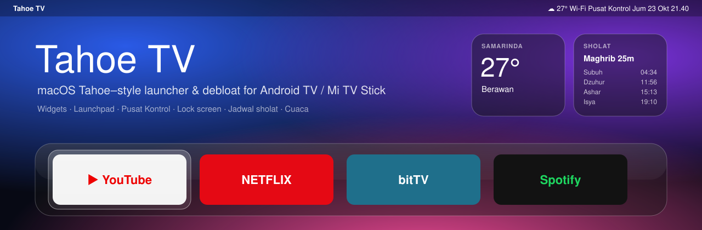
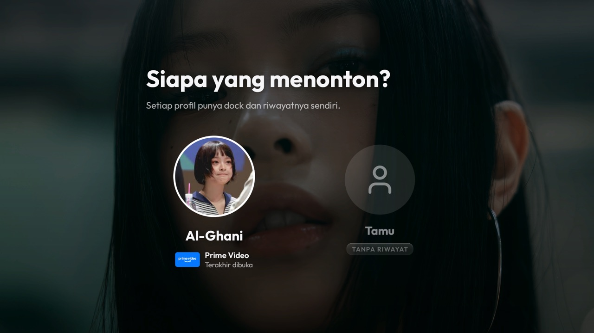
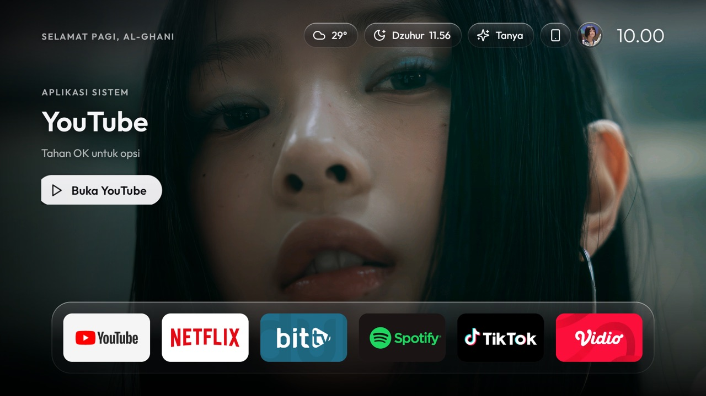
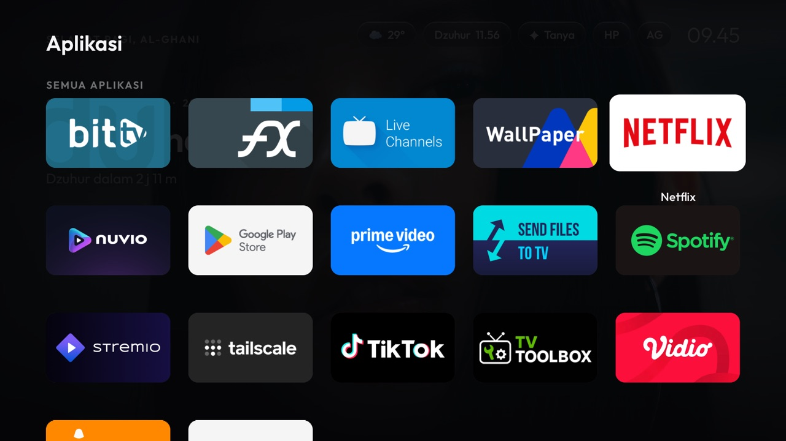
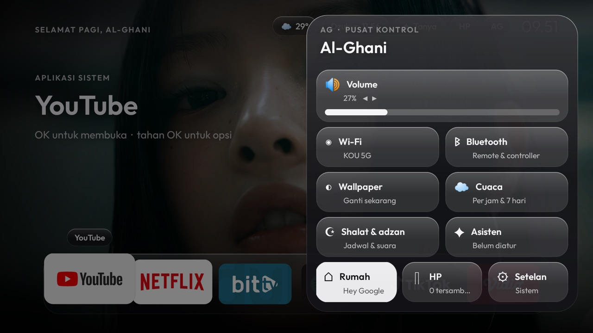
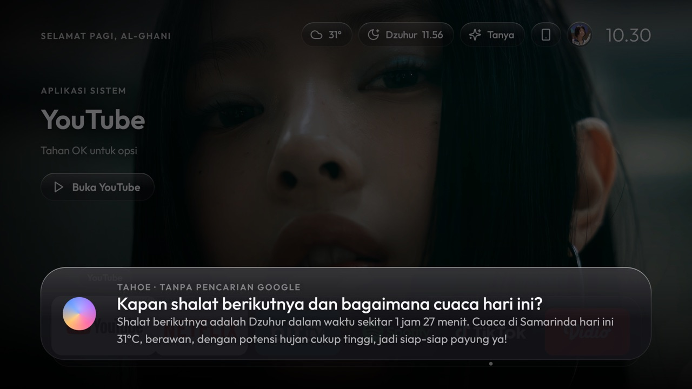
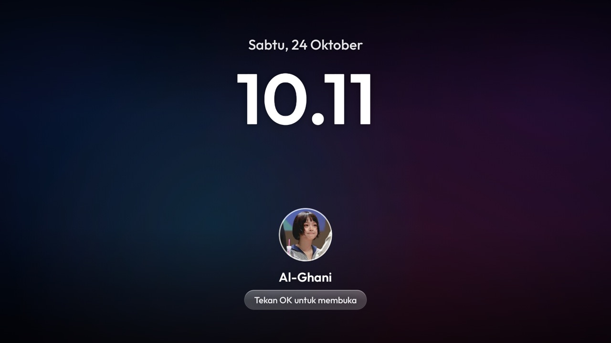
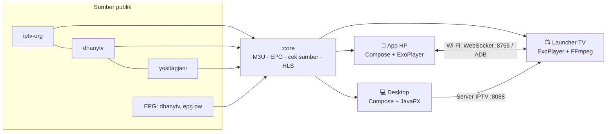

<h1 align="center">Tahoe TV</h1>

  <b>Launcher Android TV bergaya tvOS (Liquid Glass) + Live TV Indonesia gratis, untuk TV, HP, dan desktop.</b> 
  Ringan untuk TV murah: dibuat dan diuji di <b>Xiaomi Mi TV Stick (Android 9, RAM 1 GB)</b>.

  
  
  
  
  
  

  <a href="https://github.com/fk0u/cleanyourtv-tahoe/releases/latest"><b>⬇️ Unduh</b></a> ·
  <a href="#mulai-dalam-5-menit">Mulai</a> ·
  <a href="#fitur">Fitur</a> ·
  <a href="#screenshot">Screenshot</a> ·
  <a href="docs/ROADMAP.md">Roadmap</a> ·
  <a href="CONTRIBUTING.md">Kontribusi</a>

> **English:** Tahoe TV is a free, open-source, tvOS-style (Liquid Glass) home screen for Android TV, plus companion apps for Android phones and macOS/Windows. It plays 900+ free Indonesian live TV channels with a guide (EPG), picks working sources automatically, records shows on the desktop, and runs smoothly on a 1 GB Mi TV Stick. No root needed. UI is in Indonesian; contributions for English are welcome.

---

## Kenapa Tahoe TV?

- 📺 **Beranda TV yang cantik dan ringan.** Gaya tvOS 26 tanpa blur berat, jadi tetap lancar di TV stick 1 GB.
- 🇮🇩 **Live TV Indonesia gratis.** 900+ saluran (nasional, TVRI daerah, TV lokal "dekat kamu", berita, olahraga…) dengan jadwal acara, dari sumber publik.
- ⚡ **Langsung tayang.** Sumber yang hidup diputar duluan; siaran "kemarin yang diulang" dan sumber mati dilewati otomatis.
- 📱 **HP jadi remote dan pusat kendali.** Remote lengkap, ketik ke TV, kirim foto, nonton Live TV di HP, pasang Tahoe ke TV lewat Wi-Fi tanpa laptop.
- 💻 **App desktop (macOS & Windows).** Live TV, rekam acara (DVR), server IPTV untuk seluruh rumah, dan remote + cermin layar TV.
- 👨‍👩‍👧 **Profil keluarga.** Saya, Tamu, dan **Anak** (dikunci PIN, hanya saluran anak).
- 🕌 **Jadwal shalat & adzan**, cuaca, asisten Gemini, Home Assistant.
- 🔓 **Gratis, open source (MIT), tanpa iklan, tanpa root.**

## Mulai dalam 5 menit

| Saya punya… | Unduh | Lalu |
|---|---|---|
| **Android TV / TV box** (Mi TV Stick, Chromecast, dll.) | [`tahoe-tv.apk`](https://github.com/fk0u/cleanyourtv-tahoe/releases/latest/download/tahoe-tv.apk) di HP Android | Buka app HP → **Pasang** → pilih TV di Wi-Fi yang sama. Launcher terpasang otomatis ([langkah lengkap](docs/INSTALL.md#pasang-dari-hp-tanpa-laptop)) |
| **HP Android** saja | [`tahoe-tv.apk`](https://github.com/fk0u/cleanyourtv-tahoe/releases/latest/download/tahoe-tv.apk) | Nonton Live TV di HP, atau jadi remote TV |
| **Mac** (Apple Silicon / Intel) | [`TahoeTV-macos-arm64.dmg`](https://github.com/fk0u/cleanyourtv-tahoe/releases/latest/download/TahoeTV-macos-arm64.dmg) · [`TahoeTV-macos-intel.dmg`](https://github.com/fk0u/cleanyourtv-tahoe/releases/latest/download/TahoeTV-macos-intel.dmg) | Buka → TV Live. Pertama kali: klik kanan → **Buka** (app belum dinotarisasi) |
| **Windows 10/11** | [`TahoeTV-windows.msi`](https://github.com/fk0u/cleanyourtv-tahoe/releases/latest/download/TahoeTV-windows.msi) | Pasang → TV Live |
| Sudah ada launcher, mau pasang manual | [`tahoe-launcher.apk`](https://github.com/fk0u/cleanyourtv-tahoe/releases/latest/download/tahoe-launcher.apk) | Lihat [docs/INSTALL.md](docs/INSTALL.md) |

Pembaruan berikutnya datang sendiri: TV, HP, dan desktop memeriksa rilis GitHub (Pusat Kontrol → **Tentang**).

## Screenshot

| Siapa yang menonton? | Beranda |
|---|---|
|  |  |
| **Hero + tombol aksi** | **Launchpad** |
|  |  |
| **Jadwal shalat & adzan** | **Pusat Kontrol** |
|  |  |
| **Asisten (Gemini)** | **Notifikasi & musik dari HP** |
|  |  |
| **Hubungkan HP (QR + kode)** | **Screensaver hemat energi** |
|  |  |

> Wallpaper pada sebagian screenshot adalah foto pribadi pemilik perangkat dan tidak ada di repo ini.

## Fitur

### 📺 TV (launcher Android TV)
- **Tampilan tvOS 26:** material kaca, tile dengan efek lift dan kilau, dock ala macOS, Launchpad dengan rak Game, hero editorial (trending YouTube, populer di Netflix), dan transisi buka aplikasi.
- **Profil:** Saya, Tamu, dan **Anak**. Profil Anak dikunci PIN 4 angka, hanya menampilkan saluran Anak & Dokumenter dan aplikasi yang diizinkan. PIN bisa diatur ulang dari HP yang sudah dipasangkan.
- **Live TV:** daftar saluran per kategori, jadwal acara, saluran favorit dan terakhir ditonton, nomor saluran, tunda/maju 30 detik, serta loading ala Apple TV.
- **Pintar memilih sumber:** sumber hidup diputar duluan; siaran rekaman/basi dilewati; tahan **OK** untuk menandai sumber "bukan live". Dekoder cadangan + **FFmpeg** untuk audio AC-3/E-AC-3/DTS/MP2.
- **Pusat Kontrol:** volume, musik dari HP, Wi-Fi, Bluetooth, wallpaper, cuaca, shalat, asisten, rumah, timer tidur, **Kirim log**, dan pembaruan.
- **Jadwal shalat & adzan** (Kemenag RI lewat Aladhan, alarm tahan reboot), **cuaca** per jam/7 hari (Open-Meteo), **asisten Gemini**, **Home Assistant**, **gamepad**, dan **screensaver** hemat energi.

### 📱 HP (Android)
- **Pasang Tahoe ke TV lewat Wi-Fi** (ADB) tanpa laptop: debloat, nama, kota, dock, API key, pulihkan TV.
- **Remote lengkap:** D-pad/swipe, volume dengan slider, CH, nomor saluran, media, power, timer tidur, ketik ke TV, tanya asisten.
- **Pairing lewat QR** dari layar TV.
- **Live TV di HP** dengan pencarian, tunda/maju, dan dekoder FFmpeg.
- **Notifikasi & musik HP tampil di TV.**
- **Kirim log** (HP + TV sekaligus) dan **atur ulang PIN Anak**.

### 💻 Desktop (macOS 13+ & Windows)
- **TV Live** dengan status LIVE/OFFLINE per saluran, filter kategori, dan pencarian nama/acara.
- **Rekam acara (DVR)** dari jadwal, file di `~/Movies/Tahoe TV`, bisa ditonton dari TV/HP lewat LAN.
- **Server IPTV LAN:** `http://<ip>:8088/playlist.m3u` dan `/epg.xml` untuk TV, HP, VLC, Kodi, TiviMate, plus relay header.
- **TV Rumah:** temukan Android TV di Wi-Fi, pasang dan atur Tahoe. **Remote + cermin layar** lewat ADB.
- **Kirim log** ke Downloads/clipboard, langsung ke GitHub Issues.

## Bagaimana cara kerjanya

Semua logika bersama (playlist, EPG, pengecekan sumber, perekam HLS, log diagnostik) ada di modul `:core` dan dipakai ketiga aplikasi. Detail: [docs/ARCHITECTURE.md](docs/ARCHITECTURE.md).

## Dokumentasi

| Dokumen | Isi |
|---|---|
| [docs/INSTALL.md](docs/INSTALL.md) | Pasang dari HP, dari komputer (ADB), izin, konfigurasi, API key, debloat, wallpaper, mengembalikan TV |
| [docs/ARCHITECTURE.md](docs/ARCHITECTURE.md) | Modul, alur Live TV, protokol HP ↔ TV, server IPTV, build & rilis |
| [docs/ROADMAP.md](docs/ROADMAP.md) | Rencana berikutnya dan issue terkait |
| [CHANGELOG.md](CHANGELOG.md) | Catatan setiap rilis (juga tampil di dalam app) |
| [CONTRIBUTING.md](CONTRIBUTING.md) | Cara melapor bug, mengusulkan fitur, dan mengirim PR |
| [docs/brand/BRAND.md](docs/brand/BRAND.md) | Logo, warna, tipografi |

## Batasan

- **Tanpa root:** Assistant, popup volume, dan Settings sistem tidak bisa diganti; tombol tidak bisa disuntik ke aplikasi lain (Back/Home tetap bisa).
- **Notifikasi dari TV sendiri** diblokir firmware low-RAM. Solusinya app HP.
- **Saluran berbayar/DRM tidak diputar** di TV dan HP; Tahoe hanya memakai siaran gratis dari sumber publik dan tidak meng-host siaran apa pun.
- **Google TV dan webOS** belum didukung penuh: lihat [#40](https://github.com/fk0u/cleanyourtv-tahoe/issues/40) dan [#26](https://github.com/fk0u/cleanyourtv-tahoe/issues/26).

## Ikut membantu

- ⭐ **Beri bintang** repo ini kalau Tahoe TV berguna. Itu membantu orang lain menemukannya.
- 🐞 **Lapor bug:** pakai **Kirim log** di app (TV/HP/desktop), lalu buka [issue baru](https://github.com/fk0u/cleanyourtv-tahoe/issues/new/choose).
- 💡 **Usul fitur** atau ambil issue berlabel [`good first issue`](https://github.com/fk0u/cleanyourtv-tahoe/labels/good%20first%20issue) / [`help wanted`](https://github.com/fk0u/cleanyourtv-tahoe/labels/help%20wanted).
- 💬 **Tanya atau diskusi** di [Discussions](https://github.com/fk0u/cleanyourtv-tahoe/discussions).
- 📣 **Bagikan** ke grup Android TV, STB, atau komunitas IPTV Indonesia.

## Kredit & lisensi

- Kode: [MIT](LICENSE) © Al-Ghani ([@fk0u](https://github.com/fk0u)).
- Ikon [Lucide](https://lucide.dev) (ISC). Font [Outfit](https://github.com/Outfitio/Outfit-Fonts) (SIL OFL 1.1).
- Pemutar: [Media3/ExoPlayer](https://github.com/androidx/media) (Apache 2.0), dekoder FFmpeg dari [Jellyfin media3-ffmpeg-decoder](https://github.com/jellyfin/jellyfin-androidx-media) (FFmpeg: LGPL 2.1+). Server HP: [NanoHTTPD](https://github.com/NanoHttpd/nanohttpd). ADB: [dadb](https://github.com/mobile-dev-inc/dadb). QR: [ZXing](https://github.com/zxing/zxing).
- Saluran & jadwal TV: [iptv-org](https://github.com/iptv-org/iptv), [yositapjani/iptv-indonesia](https://github.com/yositapjani/iptv-indonesia), [dhanytv](https://github.com/dhasap/dhanytv) oleh @dhasap (hanya bagian TV gratis Indonesia), [epg.pw](https://epg.pw). Tahoe tidak meng-host siaran apa pun.
- Data: [Open-Meteo](https://open-meteo.com/) · [Aladhan](https://aladhan.com/prayer-times-api) · [TMDB](https://www.themoviedb.org/) (produk ini tidak didukung atau disertifikasi TMDB) · YouTube Data API · Gemini API.
- Terinspirasi dari [cleanyourtv](https://github.com/Gathin23/cleanyourtv). Bukan produk Apple; "tvOS", "macOS", dan "Liquid Glass" adalah merek Apple Inc.
