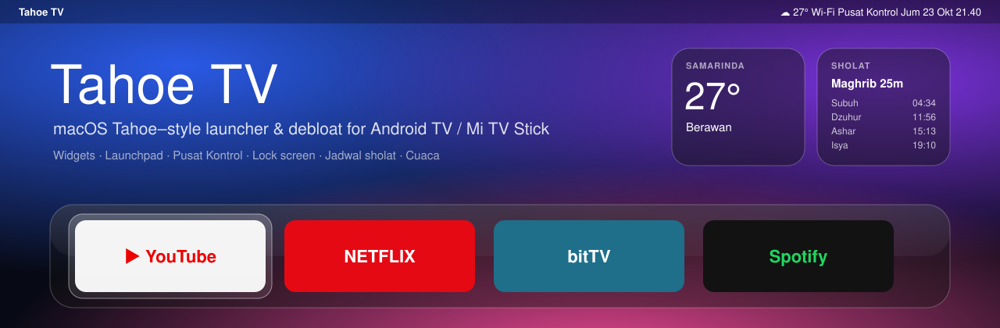
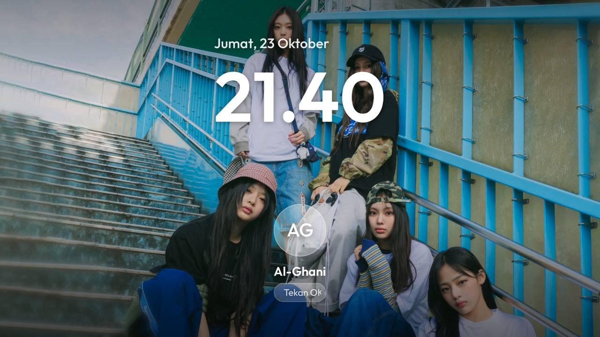
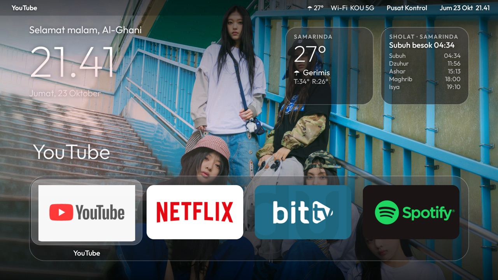
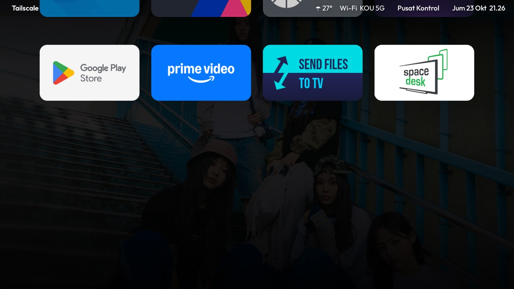
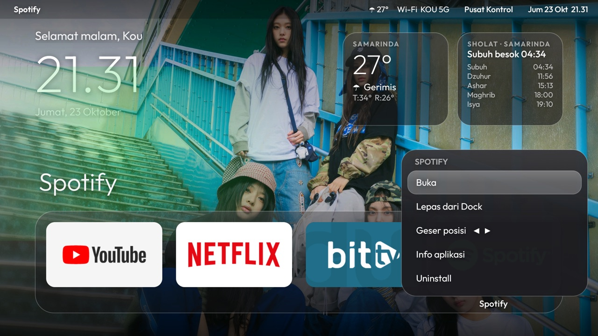
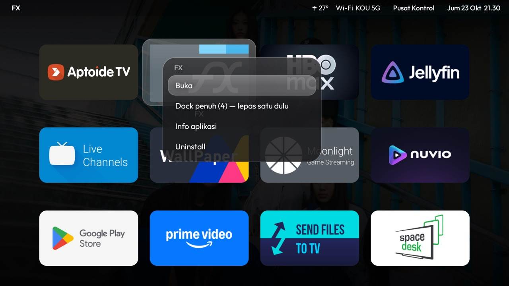
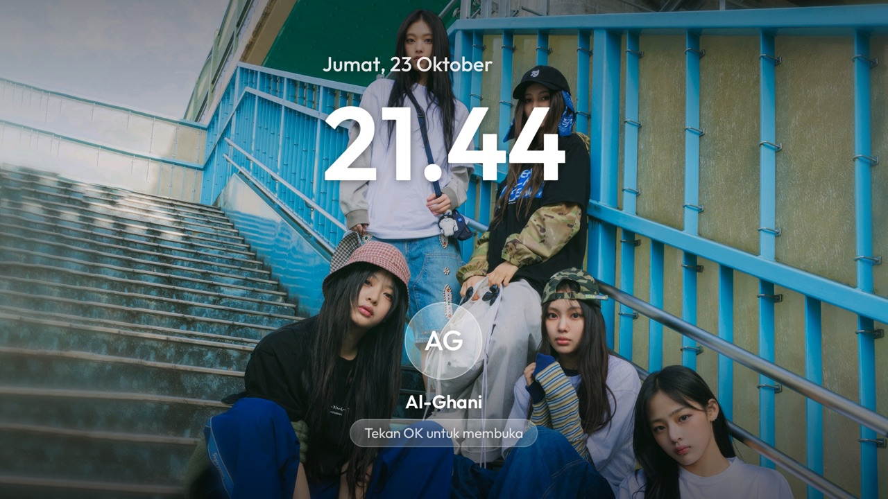

<p align="center"></p>

<p align="center">
  <b>Debloat + launcher ala macOS Tahoe untuk Android TV</b><br>
  Dibuat dan diuji di <b>Xiaomi Mi TV Stick (MiTV-AESP0, Android 9)</b>.
</p>

<p align="center">
  
  
  
  
</p>

---

> **Roadmap v2 (gaya tvOS 26):** lihat [PLAN.md](PLAN.md) dan [issues](https://github.com/fk0u/cleanyourtv-tahoe/issues?q=label%3Aroadmap).

## Daftar isi
- [Screenshot](#screenshot)
- [Fitur](#fitur)
- [Kontrol remote](#kontrol-remote)
- [Yang dibutuhkan](#yang-dibutuhkan)
- [Instalasi](#instalasi)
- [Konfigurasi](#konfigurasi)
- [Wallpaper](#wallpaper)
- [Debloat](#debloat)
- [DNS pemblokir iklan](#dns-pemblokir-iklan)
- [Batasan perangkat](#batasan-perangkat)
- [Mengembalikan semuanya](#mengembalikan-semuanya)
- [Struktur proyek](#struktur-proyek)
- [Menutup ADB](#menutup-adb)
- [Kredit & lisensi](#kredit--lisensi)

## Screenshot

| Layar kunci (boot & screensaver) | Beranda |
|---|---|
|  |  |
| **Launchpad** | **Menu tahan OK (dock)** |
|  |  |
| **Menu tahan OK (Launchpad)** | **Screensaver** |
|  |  |

> Wallpaper di screenshot adalah foto pribadi pemilik perangkat dan **tidak** disertakan di repo ini.
> Pakai wallpaper kamu sendiri (lihat [Wallpaper](#wallpaper)).

## Fitur

**Launcher (`tv.clean.home`)**
- **Menu bar** ala macOS: nama aplikasi yang difokus, cuaca, nama Wi-Fi, Pusat Kontrol, tanggal & jam.
- **Widget kaca**: greeting ("Selamat malam, Al-Ghani") + jam besar, **cuaca** (Open-Meteo), **jadwal sholat** (Aladhan, metode Kemenag RI) dengan hitung mundur ke waktu berikutnya.
- **Dock kaca** (4–7 slot) dengan highlight yang "melompat" antar tile, judul besar aplikasi + glow warna dari banner-nya.
- **Launchpad**: semua aplikasi dalam grid, wallpaper diredupkan, gulir tepat satu baris per tekan.
- **Pusat Kontrol**: volume, Wi-Fi, Bluetooth & remote, ganti wallpaper, Pengaturan.
- **Menu tahan OK** di aplikasi mana pun: Buka · Sematkan/Lepas dari Dock · Geser posisi · Info aplikasi · Uninstall.
- **Wallpaper berganti otomatis** (crossfade) dari folder di TV.
- **Layar kunci ala macOS** saat boot dan sebagai **screensaver** sistem: slideshow wallpaper, tanggal, jam, avatar inisial + nama, "Tekan OK untuk membuka".
- **Banner pengingat sholat** muncul di atas aplikasi apa pun saat masuk waktu sholat.
- **Tombol Apps** di remote membuka Launchpad dari mana saja.
- Ringan untuk TV 1 GB RAM: tanpa blur, tanpa video, wallpaper RGB_565, banner dimuat di background.

**Debloat**
- Telemetri Xiaomi, pelacak iklan Alphonso, PatchWall, baris rekomendasi, dan aplikasi bawaan yang tidak dipakai dimatikan dengan `pm disable-user` (tidak di-uninstall, bisa dikembalikan).

## Kontrol remote

| Tombol | Aksi |
|---|---|
| ◀ ▶ ▲ ▼ | Pindah tepat satu kolom/baris. Ujung baris tidak "tembus". |
| ▼ dari dock | Buka Launchpad |
| ▲ dari dock | Ke menu bar (Pusat Kontrol) |
| **OK** | Buka aplikasi / pilih item / buka layar kunci |
| **Tahan OK** | Menu aplikasi (sematkan, geser, info, uninstall) |
| **Apps** | Launchpad (dari mana saja) |
| **Menu** | Pusat Kontrol |
| **Back** | Tutup panel → kembali ke dock |
| **Home** | Selalu kembali ke dock |

## Yang dibutuhkan

- Android TV / Google TV (Android **8.0+**, `minSdk 26`). Tidak untuk Samsung Tizen, LG webOS, Fire TV.
- Mac/PC di Wi-Fi yang sama dengan TV.
- **Python 3** (untuk klien ADB `adb-shell`, tidak perlu `adb` resmi).
- **Android SDK**: `build-tools` (34+) dan `platforms/android-34`. Cukup dari Android Studio, tidak perlu Gradle.
- **JDK 17**.

Di TV: **Settings → Device Preferences → About → tekan "Build" 7×**, lalu **Developer options → USB debugging: ON**.

## Instalasi

```bash
git clone https://github.com/fk0u/cleanyourtv-tahoe.git
cd cleanyourtv-tahoe
python3 -m venv .venv && .venv/bin/pip install -r requirements.txt
export TV_HOST=192.168.1.50          # IP TV kamu
.venv/bin/python tools/tv.py 'getprop ro.product.model'   # terima prompt "Allow USB debugging?" di TV
```

**1. Backup dulu** (disimpan lokal di `backup/`, tidak ikut ke git):
```bash
mkdir -p backup
.venv/bin/python tools/tv.py 'pm list packages -f' > backup/packages.txt
.venv/bin/python tools/tv.py 'getprop' > backup/getprop.txt
for n in global secure system; do .venv/bin/python tools/tv.py "settings list $n" > backup/settings-$n.txt; done
```

**2. Build & pasang launcher:**
```bash
./build-and-install.sh            # aapt2 + javac + d8 + apksigner, lalu pm install -r
```

**3. Izin satu kali:**
```bash
.venv/bin/python tools/tv.py 'pm grant tv.clean.home android.permission.ACCESS_FINE_LOCATION'   # nama Wi-Fi
.venv/bin/python tools/tv.py 'pm grant tv.clean.home android.permission.WRITE_SECURE_SETTINGS'  # tombol Apps
.venv/bin/python tools/tv.py 'appops set tv.clean.home SYSTEM_ALERT_WINDOW allow'               # banner sholat
```

**4. Jadikan Home + screensaver:**
```bash
.venv/bin/python tools/tv.py 'cmd package set-home-activity tv.clean.home/.Home'
tools/disable.sh com.google.android.tvlauncher      # matikan launcher bawaan (bisa dikembalikan)
.venv/bin/python tools/tv.py 'settings put secure screensaver_components tv.clean.home/tv.clean.home.Lock'
```
Cek: `.venv/bin/python tools/tv.py 'dumpsys activity activities | grep mResumedActivity'` harus menunjukkan `tv.clean.home/.Home` setelah tekan Home.

> **Google TV:** sebelum mematikan `com.google.android.tungsten.setupwraith`, jalankan
> `dumpsys wifi | grep -o 'cname=[^ ]*'`. Kalau Wi-Fi tersimpan milik setupwraith, mematikannya **menghapus Wi-Fi** dan memutus ADB.

## Konfigurasi

Semua ada di [`launcher/res/values/config.xml`](launcher/res/values/config.xml). Setelah mengubah, jalankan `./build-and-install.sh`.

| Kunci | Contoh | Fungsi |
|---|---|---|
| `columns` | `4` | Jumlah slot dock = jumlah kolom Launchpad (4–7) |
| `dock_apps` | `com.netflix.ninja` … | Isi dock awal, kiri → kanan (nama paket). Aplikasi yang tidak terpasang dilewati. |
| `user_name` | `Al-Ghani` | Nama di greeting & layar kunci. Inisial avatar diambil dari sini ("AG"). Kosongkan untuk tanpa nama. |
| `city` | `Samarinda` | Label kota di widget |
| `latitude` / `longitude` | `-0.4948` / `117.1436` | Lokasi untuk cuaca & jadwal sholat |
| `wallpaper_minutes` | `10` | Interval ganti wallpaper di Beranda |

Catatan:
- **Susunan dock** yang diubah lewat menu tahan OK disimpan di TV dan menimpa `dock_apps`.
- **Jadwal sholat** memakai `method=20` (Kementerian Agama RI) dari [Aladhan](https://aladhan.com/prayer-times-api). Ganti di `Home.fetchPrayer()` kalau perlu metode lain.
- **Cuaca** dari [Open-Meteo](https://open-meteo.com/) (tanpa API key), diperbarui tiap 30 menit dan di-cache untuk offline.
- **Jeda screensaver**: Settings → Device Preferences → Screen saver.
- Mencari nama paket: `.venv/bin/python tools/tv.py 'pm list packages | grep -i netflix'`.

## Wallpaper

Wallpaper dibaca dari folder di TV: `/sdcard/Android/data/tv.clean.home/files/wallpapers/` (JPG/PNG/WebP, urut nama).
Kecilkan dulu ke 1920×1080 supaya hemat RAM:

```bash
mkdir -p wallpapers
sips -s format jpeg -s formatOptions 82 -z 1080 1920 foto.jpg --out wallpapers/01.jpg     # macOS
# Linux: convert foto.jpg -resize 1920x1080^ -gravity center -extent 1920x1080 wallpapers/01.jpg
.venv/bin/python tools/tv.py --push /sdcard/Android/data/tv.clean.home/files/wallpapers wallpapers/*.jpg
```
Tekan Home. Ganti manual: **Pusat Kontrol → Ganti wallpaper**. Folder kosong = latar hitam pekat.
Hapus satu: `.venv/bin/python tools/tv.py 'rm /sdcard/Android/data/tv.clean.home/files/wallpapers/01.jpg'`.

## Debloat

Daftar lengkap: [`debloat-list.txt`](debloat-list.txt). Jalankan **satu batch kecil per kali** dan cek layar di antaranya:

```bash
tools/disable.sh com.miui.tv.analytics tv.alphonso.alphonso_eula
.venv/bin/python tools/tv.py --screenshot shots/check.png HOME
```

| Paket | Apa |
|---|---|
| `com.miui.tv.analytics`, `tv.alphonso.alphonso_eula` | Telemetri Xiaomi, pelacak tontonan/iklan Alphonso |
| `com.google.android.feedback`, `com.google.android.tv.bugreportsender` | Feedback & laporan bug Google |
| `com.mitv.tvhome.atv`, `com.mitv.tvhome.michannel`, `com.xm.webcontent` | PatchWall + channel-nya |
| `com.google.android.tvrecommendations` | Baris rekomendasi |
| `com.google.android.youtube.tvmusic`, `com.google.android.videos`, `com.google.android.play.games` | Aplikasi Google yang tidak dipakai |
| `com.mitv.videoplayer`, `com.mitv.download.service` | Pemutar video & downloader Mi |
| `com.google.android.tvlauncher` | Launcher bawaan (diganti `tv.clean.home`) |

**Sengaja dibiarkan:** Google Assistant, Chromecast, Miracast, update firmware, Play Store/Services, setup wizard.

`tools/disable.sh` **menolak** paket inti Android (permission controller, package installer, ext services, `com.android.providers.*`, systemui, settings, dll.). Mematikan paket-paket itu pernah membuat Mi TV Stick tidak bisa boot. Jangan pernah membuka paket "factory/fac menu" untuk "lihat-lihat".

## DNS pemblokir iklan

Opsional, Android 9+:
```bash
.venv/bin/python tools/tv.py 'settings put global private_dns_specifier dns.adguard-dns.com'
.venv/bin/python tools/tv.py 'settings put global private_dns_mode hostname'
```
Memblokir domain iklan/pelacak di kebanyakan aplikasi, **tapi tidak iklan YouTube**.
Matikan: Settings → Network → Private DNS → Automatic, atau `settings put global private_dns_mode opportunistic`.

## Batasan perangkat

- **Tidak ada notifikasi aplikasi & Now Playing di Mi TV Stick.** Firmware-nya low-RAM (`ro.config.low_ram=true`). Android menolak akses notification-listener untuk aplikasi non-sistem dan menghapusnya lagi saat boot. Banner sholat tetap jalan karena cuma butuh izin overlay.
- **Google Assistant, popup volume, dan aplikasi Settings** milik sistem. Tidak bisa didesain ulang tanpa root.
- **Volume di Pusat Kontrol** mengatur volume stream stick. Di stick yang volumenya lewat HDMI-CEC, efeknya tergantung TV.
- **Tombol Apps:** Android mengirimnya ke *home sistem* (yang mengabaikannya), jadi layanan aksesibilitas kecil (`Keys`) menangkap tombol itu saja. Firmware mematikan layanan aksesibilitas tiap boot, lalu launcher menyalakannya lagi via `WRITE_SECURE_SETTINGS`.
  Matikan: Settings → Accessibility, atau `settings put secure enabled_accessibility_services ""`.
- Di beberapa TV (misalnya TCL Google TV 12), layanan penyaring tombol membuat **tahan tombol volume** jadi satu langkah per tekan. Di Mi TV Stick tidak bermasalah.

## Mengembalikan semuanya

```bash
./restore.sh                                                         # enable lagi semua paket yang dimatikan
.venv/bin/python tools/tv.py 'pm enable com.google.android.tvlauncher'
.venv/bin/python tools/tv.py 'pm uninstall tv.clean.home'
.venv/bin/python tools/tv.py 'settings put secure screensaver_components com.mitv.dream/com.mitv.dream.MiDream'
.venv/bin/python tools/tv.py 'settings put global private_dns_mode opportunistic'
```
Satu aplikasi saja: `.venv/bin/python tools/tv.py 'pm enable <paket>'`.

## Struktur proyek

```
launcher/
  AndroidManifest.xml          Home + screensaver (Lock) + layanan tombol Apps (Keys)
  res/values/config.xml        ← konfigurasi
  res/values/styles.xml        tema hitam (tanpa flash abu-abu saat start)
  res/xml/keys.xml             konfigurasi layanan aksesibilitas
  assets/Outfit.ttf, OFL.txt   font Outfit (SIL OFL 1.1)
  src/tv/clean/home/
    Home.java                  launcher: menu bar, widget, dock, Launchpad, Pusat Kontrol, menu tahan OK
    Lock.java                  layar kunci + screensaver (DreamService)
    Notif.java                 banner overlay + perhitungan waktu sholat
    Keys.java                  tangkap tombol Apps → Launchpad
tools/
  tv.py                        klien ADB: perintah shell, --screenshot, --install, --push
  disable.sh                   pm disable-user dengan penolakan paket inti + log
  adb-closed.py                cek port 5555 benar-benar tertutup
build-and-install.sh           build APK tanpa Gradle, lalu pasang
restore.sh                     enable lagi semua yang dimatikan
debloat-list.txt               daftar paket yang dimatikan di Mi TV Stick
```

Variabel lingkungan `tools/tv.py`: `TV_HOST` (wajib), `TV_PORT` (default `5555`).
Screenshot sambil menekan tombol: `tools/tv.py --screenshot out.png DPAD_DOWN DPAD_RIGHT`.

## Menutup ADB

Port 5555 itu plaintext. Setelah selesai:
1. Settings → Developer options → matikan **USB debugging**.
2. **Revoke USB debugging authorisations**.
3. Reboot, lalu cek: `python3 tools/adb-closed.py <ip-tv>` harus mencetak `closed (connection refused)`.

Izin yang sudah diberikan (tombol Apps, banner, nama Wi-Fi) tetap berlaku setelah debugging dimatikan.

## Kredit & lisensi

- Kode: [MIT](LICENSE) © Al-Ghani ([@fk0u](https://github.com/fk0u)).
- Font [Outfit](https://github.com/Outfitio/Outfit-Fonts): SIL Open Font License 1.1 ([`launcher/assets/OFL.txt`](launcher/assets/OFL.txt)).
- Cuaca: [Open-Meteo](https://open-meteo.com/) · Jadwal sholat: [Aladhan API](https://aladhan.com/prayer-times-api).
- Terinspirasi dari prompt [cleanyourtv](https://github.com/Gathin23/cleanyourtv).
- Bukan produk Apple. "macOS" dan "Tahoe" adalah merek dagang Apple Inc.; nama aplikasi dan logo di screenshot milik pemiliknya masing-masing.
