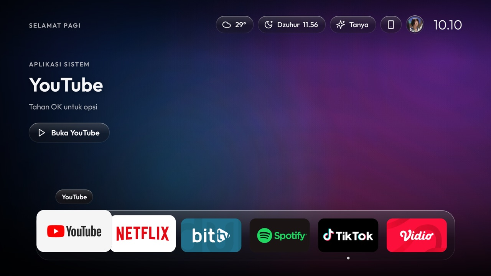
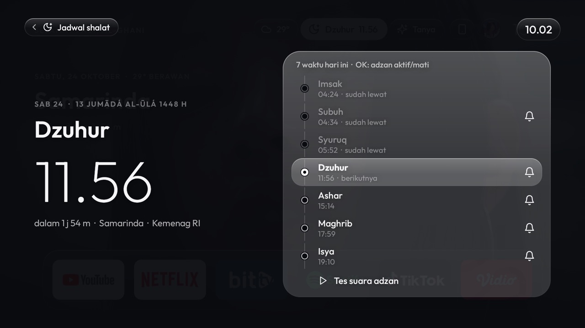
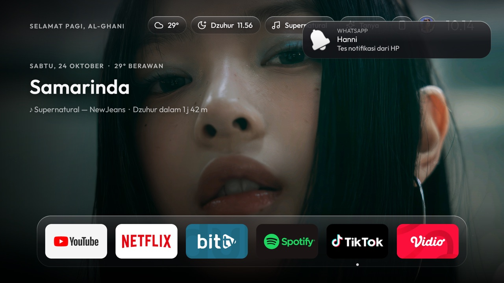
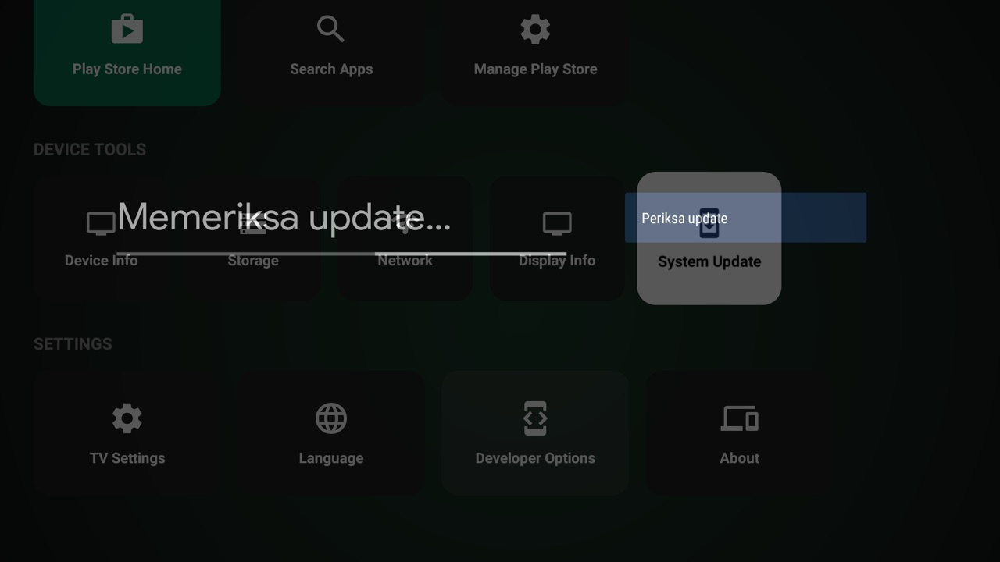
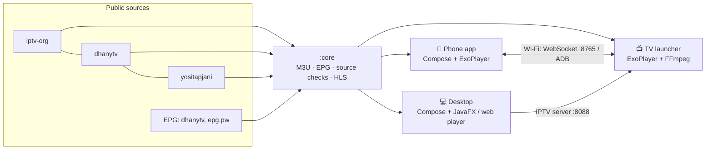

<b>English</b> · <a href="README.id.md">Bahasa Indonesia</a> · <a href="README.zh.md">中文</a>

<h1 align="center">Tahoe TV</h1>

  <b>Tahoe TV: calm, simple TV for the whole family. 
  A free, open-source, calm glass-style home screen for Android TV, with free live TV, 
  plus companion apps for Android phones, macOS and Windows.</b> 
  Built for cheap TVs: made and tested on a <b>Xiaomi Mi TV Stick (Android 9, 1 GB RAM)</b>.

  
  
  
  
  
  
  

  <a href="https://github.com/fk0u/cleanyourtv-tahoe/releases/latest"><b>⬇️ Download</b></a> ·
  <a href="https://tahoe.kousozo.tech">🌐 Website</a> ·
  <a href="#get-started-in-5-minutes">Get started</a> ·
  <a href="#features">Features</a> ·
  <a href="#screenshots">Screenshots</a> ·
  <a href="docs/ROADMAP.md">Roadmap</a> ·
  <a href="CONTRIBUTING.md">Contribute</a>

> [!NOTE]
> **Tahoe TV is a worldwide, community open-source project.** It's MIT-licensed: use it, study it, configure it,
> fork it and ship your own build — and pull requests are welcome from anyone, anywhere, in any language.
> It started in Indonesia and now speaks English, Bahasa Indonesia and 中文, with free channels from every country
> ([#71](https://github.com/fk0u/cleanyourtv-tahoe/issues/71)). Want your country or language in? [Jump in](#contributing).

## Why this exists

Tahoe TV began as a side project born out of boredom — and out of a real annoyance. The TV at home had a stock
launcher that was dull, cluttered with ads and hard to use, and the people who struggled most were older family
members: tiny text, confusing menus, and live TV hidden behind apps instead of just *turning on and changing the channel*.

So the goal became simple: **a TV home screen that is beautiful, calm and easy for everyone — including grandparents**,
where live TV behaves like a normal TV (▲ ▼ to change channel, a clear "what's on now"), that runs well on a cheap
1 GB TV stick, and that is free for anyone in the world to use and improve.

---

## Why Tahoe TV?

- 📺 **A beautiful home screen that stays light.** Calm glass-style look without heavy real-time blur, so it runs smoothly on a 1 GB TV stick.
- 👵 **Easy for everyone.** Big readable tiles, one-step navigation with the remote, and live TV that works like a native TV: ▲ ▼ changes channel, the guide shows what's on now. (Consistent channel numbers for every country's lineup are coming.)
- 🗣️ **Your language first.** First-run setup on TV, phone and desktop starts with the language (English, Bahasa Indonesia, 中文), then your country, city, prayer times, channels and favourites.
- 🌍 **Free live TV.** 1,000+ free channels today (Indonesia first: national, regional, "near you", news, sports…) with a program guide, from public sources. Every country is next ([#71](https://github.com/fk0u/cleanyourtv-tahoe/issues/71)).
- ⚡ **Plays right away.** Working sources play first; reruns of yesterday's broadcast and dead sources are skipped automatically. Choose quality (Auto/1080p/720p/480p) and latency.
- 📱 **Your phone is the remote and the control center.** Full remote, type on the TV, send photos, watch on the phone, install Tahoe on the TV over Wi-Fi without a computer.
- 💻 **Desktop app (macOS & Windows).** Live TV, recording (DVR), an IPTV server for the whole home, and TV remote + screen mirroring.
- 👨‍👩‍👧 **Family profiles.** Me, Guest and **Kids** (PIN-locked, kids' channels only).
- 🕌 **Prayer times & adhan**, weather, Gemini assistant, Home Assistant.
- 🔓 **Free, open source (MIT), no ads, no root.**

## Get started in 5 minutes

| I have… | Download | Then |
|---|---|---|
| **Android TV / TV box** (Mi TV Stick, Chromecast, …) | [`tahoe-tv.apk`](https://github.com/fk0u/cleanyourtv-tahoe/releases/latest/download/tahoe-tv.apk) on an Android phone | Open the phone app → **Install** → pick your TV on the same Wi-Fi. The launcher installs itself ([full steps](docs/INSTALL.md#install-from-your-phone-no-computer)) |
| **An Android phone** only | [`tahoe-tv.apk`](https://github.com/fk0u/cleanyourtv-tahoe/releases/latest/download/tahoe-tv.apk) | Watch live TV on the phone, or use it as a TV remote |
| **Mac** (Apple Silicon / Intel) | [`TahoeTV-macos-arm64.dmg`](https://github.com/fk0u/cleanyourtv-tahoe/releases/latest/download/TahoeTV-macos-arm64.dmg) · [`TahoeTV-macos-intel.dmg`](https://github.com/fk0u/cleanyourtv-tahoe/releases/latest/download/TahoeTV-macos-intel.dmg) | Open → Live TV. First time: right-click → **Open** (the app isn't notarized yet) |
| **Windows 10/11** | [`TahoeTV-windows.msi`](https://github.com/fk0u/cleanyourtv-tahoe/releases/latest/download/TahoeTV-windows.msi) | Install → Live TV |
| A launcher already, want to install by hand | [`tahoe-launcher.apk`](https://github.com/fk0u/cleanyourtv-tahoe/releases/latest/download/tahoe-launcher.apk) | See [docs/INSTALL.md](docs/INSTALL.md) |

Updates are checked automatically: the TV, phone and desktop apps check GitHub releases (Control Center → **About**) so you can download and install them.

## Screenshots

**On the TV**

**On the phone**

More screenshots (full size)

| Home | **Prayer times & adhan** |
|---|---|
|  |  |
| **Phone notifications & music** | **Connect a phone (QR + code)** |
|  |  |

## Features

### 📺 TV (Android TV launcher)
- **Calm, cinematic look:** glass-style tiles with lift and shine, a floating dock, Launchpad with a Games shelf, an editorial hero (YouTube trending, popular on Netflix) and app-opening transitions.
- **Profiles:** Me, Guest and **Kids**. Kids is locked with a 4-digit PIN and only shows kids' & documentary channels and allowed apps. The PIN can be reset from a paired phone.
- **Live TV:** channels by category, program guide, favorites and recently watched, channel numbers, 30-second pause/skip, a calm fullscreen loader, and quality + latency options.
- **Smart source picking:** live sources first; recorded/stale broadcasts skipped; hold **OK** to mark a source "not live". Fallback decoders + **FFmpeg** for AC-3/E-AC-3/DTS/MP2 audio.
- **Control Center:** volume, phone music, Wi-Fi, Bluetooth, wallpaper, weather, prayer times, assistant, home, sleep timer, **Send log** and updates.
- **Prayer times & adhan**, hourly/7-day **weather** (Open-Meteo), **Gemini assistant**, **Home Assistant**, **gamepads** and an energy-saving **screensaver**.

### 📱 Phone (Android)
- **Install Tahoe on the TV over Wi-Fi** (ADB) without a computer: debloat, name, city, dock, API keys, restore the TV.
- **Full remote:** D-pad/swipe, volume slider, channels, number pad, media, power, sleep timer, type on the TV, ask the assistant.
- **Live TV on the phone** with a mini player, channel pages, favorites, search, quality and latency settings.
- **QR pairing** from the TV screen, **phone notifications & music on the TV**, **Send log** and **Kids PIN reset**.

### 💻 Desktop (macOS 13+ & Windows 10/11)
- **Live TV** with LIVE/OFFLINE status per channel, categories, and search by channel or show. On Windows it plays in a lightweight Edge window.
- **Recording (DVR)** from the guide, saved to `~/Movies/Tahoe TV`, watchable from the TV/phone over the LAN.
- **LAN IPTV server:** `http://<ip>:8088/playlist.m3u` and `/epg.xml` for TVs, phones, VLC, Kodi, TiviMate, with a header relay.
- **Home TVs:** find Android TVs on the Wi-Fi, install and set up Tahoe, **remote + screen mirroring** over ADB.

## How it works

All shared logic (playlists, EPG, source checks, the HLS recorder, diagnostics) lives in the `:core` module used by all
three apps. Details: [docs/ARCHITECTURE.md](docs/ARCHITECTURE.md).

## Documentation

| Document | English | Bahasa Indonesia |
|---|---|---|
| Install & configure | [INSTALL.md](docs/INSTALL.md) | [INSTALL.md](docs/id/INSTALL.md) |
| Architecture | [ARCHITECTURE.md](docs/ARCHITECTURE.md) | [ARCHITECTURE.md](docs/id/ARCHITECTURE.md) |
| Roadmap | [ROADMAP.md](docs/ROADMAP.md) | [ROADMAP.md](docs/id/ROADMAP.md) |
| Contributing | [CONTRIBUTING.md](CONTRIBUTING.md) | [CONTRIBUTING.md](docs/id/CONTRIBUTING.md) |
| Security | [SECURITY.md](SECURITY.md) | [SECURITY.md](SECURITY.md#bahasa-indonesia) |
| Channel sources & takedown | [SOURCES.md](docs/SOURCES.md) | [SOURCES.md](docs/SOURCES.md#bahasa-indonesia) |
| Code of conduct | [CODE_OF_CONDUCT.md](CODE_OF_CONDUCT.md) | [CODE_OF_CONDUCT.md](CODE_OF_CONDUCT.md#bahasa-indonesia) |
| Maintainers | [MAINTAINERS.md](MAINTAINERS.md) | |
| Release notes | [CHANGELOG.md](CHANGELOG.md) | (Indonesian, shown in the apps) |
| Brand | [BRAND.md](docs/brand/BRAND.md) | |

Translating a document into your language? Add it under `docs/<language-code>/` and link it here.

## Limitations

- **No root:** the Assistant, volume popup and system Settings can't be replaced; keys can't be injected into other apps (Back/Home still work).
- **Notifications from the TV itself** are blocked by low-RAM firmware; the phone app is the workaround.
- **Paid/DRM channels don't play** on the TV and phone; Tahoe only uses free broadcasts from public sources and hosts no streams.
- **Google TV and webOS** aren't fully supported yet: see [#40](https://github.com/fk0u/cleanyourtv-tahoe/issues/40) and [#26](https://github.com/fk0u/cleanyourtv-tahoe/issues/26).

## Contributing

Tahoe TV is **free and open to everyone, worldwide**: fork it, configure it for your country or family, ship your own
version under the MIT license, or send your improvements back. Pull requests are welcome from anyone — issues and
PRs in English, Bahasa Indonesia or 中文 are all fine. Every kind of help counts:

- ⭐ **Star** the repo if Tahoe TV is useful. It helps others find it.
- 🌍 **Translate** the apps or docs, or **add your country's channels** ([#71](https://github.com/fk0u/cleanyourtv-tahoe/issues/71), [#56](https://github.com/fk0u/cleanyourtv-tahoe/issues/56)).
- 🐞 **Report bugs:** use **Send log** in the app, then open a [new issue](https://github.com/fk0u/cleanyourtv-tahoe/issues/new/choose).
- 💡 **Pick an issue:** [`good first issue`](https://github.com/fk0u/cleanyourtv-tahoe/labels/good%20first%20issue) · [`help wanted`](https://github.com/fk0u/cleanyourtv-tahoe/labels/help%20wanted).
- 💬 **Ask or discuss** in [Discussions](https://github.com/fk0u/cleanyourtv-tahoe/discussions).

Start with [CONTRIBUTING.md](CONTRIBUTING.md). Security issues go to [SECURITY.md](SECURITY.md), never to public issues.

### Contributors

Thanks to everyone who has helped build Tahoe TV:

## Credits & license

- Code: [MIT](LICENSE) © Al-Ghani ([@fk0u](https://github.com/fk0u)) and contributors.
- Icons: [Lucide](https://lucide.dev) (ISC). Font: [Outfit](https://github.com/Outfitio/Outfit-Fonts) (SIL OFL 1.1).
- Players: [Media3/ExoPlayer](https://github.com/androidx/media) (Apache 2.0), FFmpeg decoder from [Jellyfin media3-ffmpeg-decoder](https://github.com/jellyfin/jellyfin-androidx-media) (FFmpeg: LGPL 2.1+), [hls.js](https://github.com/video-dev/hls.js) (Apache 2.0), [Shaka Player](https://github.com/shaka-project/shaka-player) (Apache 2.0). Phone server: [NanoHTTPD](https://github.com/NanoHttpd/nanohttpd). ADB: [dadb](https://github.com/mobile-dev-inc/dadb). QR: [ZXing](https://github.com/zxing/zxing).
- Channels & guides: [iptv-org](https://github.com/iptv-org/iptv), [yositapjani/iptv-indonesia](https://github.com/yositapjani/iptv-indonesia), [dhanytv](https://github.com/dhasap/dhanytv) by @dhasap (free Indonesian TV only), [epg.pw](https://epg.pw). Tahoe hosts no streams.
- Data: [Open-Meteo](https://open-meteo.com/) · [Aladhan](https://aladhan.com/prayer-times-api) · [TMDB](https://www.themoviedb.org/) (this product isn't endorsed or certified by TMDB) · YouTube Data API · Gemini API.
- Inspired by [cleanyourtv](https://github.com/Gathin23/cleanyourtv). Independent open-source project; not an Apple product or affiliated with Apple Inc.
