<a href="README.md">English</a> · <a href="README.id.md">Bahasa Indonesia</a> · <b>中文</b>

<h1 align="center">Tahoe TV</h1>

  <b>Tahoe TV：安静、简单，全家都会用的电视。 
  免费、开源、安静玻璃质感的 Android TV 主屏幕，自带免费电视直播， 
  并提供 Android 手机、macOS 和 Windows 配套应用。</b> 
  专为平价电视打造：在 <b>小米电视棒（Android 9，1 GB 内存）</b> 上开发和测试。

  
  
  
  
  
  

  <a href="https://github.com/fk0u/cleanyourtv-tahoe/releases/latest"><b>⬇️ 下载</b></a> ·
  <a href="https://tahoe.kousozo.tech">🌐 网站</a> ·
  <a href="#5-分钟上手">上手</a> ·
  <a href="#功能">功能</a> ·
  <a href="#截图">截图</a> ·
  <a href="docs/ROADMAP.md">路线图</a> ·
  <a href="CONTRIBUTING.md">参与贡献</a>

> [!NOTE]
> **Tahoe TV 是一个面向全球的社区开源项目。** 采用 MIT 许可证：可以自由使用、学习、配置、fork，
> 并发布你自己的版本——欢迎来自任何地方、使用任何语言的 Pull Request。项目起源于印度尼西亚，
> 现已支持 English、Bahasa Indonesia 和 中文，并提供来自世界各国的免费频道
> （[#71](https://github.com/fk0u/cleanyourtv-tahoe/issues/71)）。想加入你的国家或语言？[来参与吧](#参与贡献)。

## 项目缘起

Tahoe TV 起初只是作者闲来无事做的一个业余项目——也源于一个真实的烦恼。家里电视自带的桌面
单调乏味、塞满广告、而且很难用，最吃力的恰恰是家里的老人：字太小、菜单让人困惑，直播电视
被藏在各种应用后面，而不是像普通电视那样*一开机就能换台*。

于是目标变得很简单：**做一个美观、安静、人人都能轻松使用（包括爷爷奶奶）的电视主屏幕**，
让直播电视像普通电视一样操作（▲ ▼ 换台，清楚显示"正在播出什么"），在廉价的 1 GB 电视棒上
流畅运行，并且让世界上任何人都能免费使用和改进。

---

## 为什么选择 Tahoe TV？

- 📺 **美观又轻快的主屏幕。** 安静玻璃质感界面，没有沉重的实时模糊，在 1 GB 电视棒上也很流畅。
- 👵 **人人都会用。** 大而清晰的图块、遥控器一步到位的导航、像普通电视一样的直播：▲ ▼ 换台，节目表显示当前节目。（各国统一的频道编号即将推出。）
- 🗣️ **先选你的语言。** 电视、手机和电脑的首次设置都从语言开始（English、Bahasa Indonesia、中文），然后是国家、城市、礼拜时间、频道和收藏。
- 🌍 **免费直播电视。** 来自公开来源（iptv-org）的世界各国免费频道和节目表，可同时选择多个国家。
- ⚡ **即点即播。** 优先播放可用的信号源，自动跳过录像重播和失效源；可选画质（自动/1080p/720p/480p）和延迟。频道无法播放时，会显示三种语言的提示并在后台自动重试。
- 📱 **手机就是遥控器和控制中心。** 完整遥控、向电视输入文字、发送照片、在手机上看直播，无需电脑即可通过 Wi-Fi 把 Tahoe 安装到电视上。
- 💻 **桌面应用（macOS 和 Windows）。** 直播、录制（DVR）、全家共享的 IPTV 服务器，以及电视遥控和投屏。
- 👨‍👩‍👧 **家庭档案。** 我、访客和**儿童**（PIN 锁定，仅儿童频道）。
- 🔓 **免费、开源（MIT）、无广告、无需 root。**

## 5 分钟上手

| 我有… | 下载 | 然后 |
|---|---|---|
| **Android TV / 电视盒子**（小米电视棒、Chromecast 等） | 在 Android 手机上安装 [`tahoe-tv.apk`](https://github.com/fk0u/cleanyourtv-tahoe/releases/latest/download/tahoe-tv.apk) | 打开手机应用 → **安装** → 选择同一 Wi-Fi 下的电视，启动器会自动安装（[详细步骤](docs/INSTALL.md)） |
| 只有 **Android 手机** | [`tahoe-tv.apk`](https://github.com/fk0u/cleanyourtv-tahoe/releases/latest/download/tahoe-tv.apk) | 在手机上看直播，或当作电视遥控器 |
| **Mac**（Apple 芯片 / Intel） | [`TahoeTV-macos-arm64.dmg`](https://github.com/fk0u/cleanyourtv-tahoe/releases/latest/download/TahoeTV-macos-arm64.dmg) · [`TahoeTV-macos-intel.dmg`](https://github.com/fk0u/cleanyourtv-tahoe/releases/latest/download/TahoeTV-macos-intel.dmg) | 打开 → 电视直播。首次打开：右键 → **打开**（应用尚未公证） |
| **Windows 10/11** | [`TahoeTV-windows.msi`](https://github.com/fk0u/cleanyourtv-tahoe/releases/latest/download/TahoeTV-windows.msi) | 安装 → 电视直播 |

之后的更新会自动推送：电视、手机和电脑都会检查 GitHub 上的新版本。

## 截图

**电视端**

**手机端**

应用界面文字目前除首次设置外仍以印尼语为主，完整翻译正在进行中（[#56](https://github.com/fk0u/cleanyourtv-tahoe/issues/56)）——欢迎帮忙翻译！

## 功能

### 📺 电视（Android TV 启动器）
- **安静、影院级外观：** 玻璃材质、带抬起和光泽效果的图块、悬浮 Dock、启动台和精选内容。
- **首次设置：** 语言、国家、城市、时区、礼拜时间、频道国家、类别、收藏及其顺序；也可以从已配对的手机一键发送。
- **直播电视：** 按类别浏览频道、节目表、收藏、频道编号、暂停/快进 30 秒、画质和延迟选项。
- **控制中心：** 音量、手机音乐、Wi-Fi、蓝牙、壁纸、天气、礼拜时间、助手、睡眠定时器和更新。

### 📱 手机（Android）
- **通过 Wi-Fi 把 Tahoe 安装到电视**，无需电脑；完整遥控器、二维码配对、手机通知和音乐显示在电视上。
- **手机看直播：** 迷你播放器、频道页、收藏、搜索、画质和延迟设置。

### 💻 桌面（macOS 13+ 和 Windows 10/11）
- **直播电视、录制（DVR）、局域网 IPTV 服务器**（`http://<ip>:8088/playlist.m3u`），以及电视遥控和投屏。

## 工作原理

所有共享逻辑（播放列表、节目表、信号源检测、HLS 录制、诊断、首次设置模型）都在 `:core` 模块中，三个应用共同使用。详见 [docs/ARCHITECTURE.md](docs/ARCHITECTURE.md)（英文）。

## 文档

| 文档 | English | Bahasa Indonesia |
|---|---|---|
| 安装与配置 | [INSTALL.md](docs/INSTALL.md) | [INSTALL.md](docs/id/INSTALL.md) |
| 架构 | [ARCHITECTURE.md](docs/ARCHITECTURE.md) | [ARCHITECTURE.md](docs/id/ARCHITECTURE.md) |
| 路线图 | [ROADMAP.md](docs/ROADMAP.md) | [ROADMAP.md](docs/id/ROADMAP.md) |
| 参与贡献 | [CONTRIBUTING.md](CONTRIBUTING.md) | [CONTRIBUTING.md](docs/id/CONTRIBUTING.md) |

想把文档翻译成中文？请放在 `docs/zh/` 下并在这里添加链接。

## 限制

- **无需 root：** 系统助手、音量弹窗和系统设置无法替换。
- **付费/DRM 频道无法在电视和手机上播放；** Tahoe 只使用公开来源的免费节目，不托管任何直播流。

## 参与贡献

Tahoe TV **对全世界所有人免费开放**：fork 它、为你的国家或家人配置它、以 MIT 许可证发布你自己的版本，
或者把改进提交回来。欢迎任何人提交 Pull Request——用 English、Bahasa Indonesia 或 中文 提交 issue 和 PR 都可以。

- ⭐ 觉得有用就点个 **Star**，让更多人发现它。
- 🌍 **翻译**应用或文档，或**添加你所在国家的频道**（[#71](https://github.com/fk0u/cleanyourtv-tahoe/issues/71)、[#56](https://github.com/fk0u/cleanyourtv-tahoe/issues/56)）。
- 🐞 **报告问题：** 在应用里使用"发送日志"，然后新建 [issue](https://github.com/fk0u/cleanyourtv-tahoe/issues/new/choose)。
- 💡 **认领任务：** [`good first issue`](https://github.com/fk0u/cleanyourtv-tahoe/labels/good%20first%20issue) · [`help wanted`](https://github.com/fk0u/cleanyourtv-tahoe/labels/help%20wanted)。

请先阅读 [CONTRIBUTING.md](CONTRIBUTING.md)。安全问题请通过 [SECURITY.md](SECURITY.md) 私下报告，不要公开发 issue。

### 贡献者

## 致谢与许可

- 代码：[MIT](LICENSE) © Al-Ghani（[@fk0u](https://github.com/fk0u)）及所有贡献者。
- 频道与节目表来自 [iptv-org](https://github.com/iptv-org/iptv)、[epg.pw](https://epg.pw) 等公开来源；Tahoe 不托管任何直播流。
- 灵感来自 [cleanyourtv](https://github.com/Gathin23/cleanyourtv)。独立开源项目，非 Apple 产品，亦与 Apple Inc. 无关。
