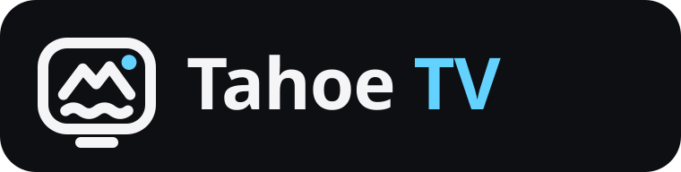

# Tahoe TV — Brand & Design System

> **Tahoe TV: TV yang tenang dan mudah, untuk seisi rumah.**
> - EN: *Tahoe TV: calm, simple TV for the whole family.*
> - ZH: *Tahoe TV：安静、简单，全家都会用的电视。*

## 1. Ide brand: "Danau di malam hari"

Nama **Tahoe** berasal dari danau pegunungan (Danau Tahoe) — bukan mengacu pada nama OS pihak ketiga. Sebelum listing di toko aplikasi publik (Play Store / App Store), lakukan pengecekan cepat merek dagang & nama untuk wilayah distribusi target.

Seluruh identitas dibangun dari satu gambaran:
**permukaan danau yang gelap dan tenang (Night), diterangi satu cahaya yang jernih (Tahoe Cyan),
dengan kedalaman air di bawahnya (Lake).**

Artinya untuk desain:

| Prinsip | Dalam praktik |
|---|---|
| **Tenang** | Latar gelap, sedikit garis, tanpa dekorasi yang bergerak terus. Konten (siaran, poster, logo saluran) yang jadi pusat. |
| **Satu cahaya** | Hanya satu warna aksen: Cyan. Dipakai untuk fokus, aksi utama, progres, dan "live". Jangan tambah aksen kedua. |
| **Dalam** | Gradien Cyan → Lake hanya untuk momen brand: ikon aplikasi, banner TV, tombol utama yang besar. |
| **Rapi** | Grid 4-pt, radius konsisten, tiga tingkat teks. Semua angka berasal dari token. |

## 2. Logo

| File | Pakai untuk |
|---|---|
| [`logo-mark.svg`](logo-mark.svg) | Mark di atas latar gelap (default) |
| [`logo-mark-dark.svg`](logo-mark-dark.svg) | Mark di atas latar terang |
| [`logo-app-icon.svg`](logo-app-icon.svg) / [`app-icon-1024.png`](app-icon-1024.png) | Ikon aplikasi, avatar, store listing |
| [`logo-lockup.svg`](logo-lockup.svg) | Mark + wordmark (README, situs, splash) |
| [`tv-banner.svg`](tv-banner.svg) | Banner Android TV 320×180 |

**Mark:** layar TV dengan dudukan, dua puncak gunung di atas gelombang danau, dan satu titik cahaya "live" berwarna Cyan.
Digambar di grid 24 unit dengan garis 2 unit, ujung membulat. Geometrinya didefinisikan sekali di
`Brand.MARK_PATH` (kode) dan di [`build-icons.sh`](build-icons.sh) (semua ikon), jadi semua platform menampilkan bentuk yang sama.

**Wordmark:** "Tahoe TV" dalam Outfit Bold, tracking −0,5. Di atas latar gelap, "TV" boleh berwarna Cyan.

Di dalam aplikasi, logo tampil sebagai `BrandTile` (ikon aplikasi versi mini): di header Beranda pada ponsel dan di atas rail pada desktop.
Mark saja tersedia sebagai `BrandMark`.

**Aturan:**
- Ruang kosong di sekeliling logo minimal setinggi titik cahaya × 2.
- Ukuran minimum: mark 16 px, lockup 96 px lebar.
- ✗ Jangan ubah warna titik cahaya selain Cyan / Cyan Light. ✗ Jangan beri bayangan, outline, atau efek 3D.
- ✗ Jangan putar, renggangkan, atau ganti font wordmark. ✗ Jangan tulis "TahoeTV" atau "TAHOE TV" di teks biasa: selalu **Tahoe TV**.

Ubah logo? Edit `build-icons.sh` dan `Brand.MARK_PATH`, lalu jalankan `sh docs/brand/build-icons.sh`.
Skrip ini membuat ulang ikon adaptif Android (ponsel + launcher), banner TV, serta `icon.png`, `.icns`, dan `.ico` desktop.

## 3. Warna

Sumber kebenaran: [`core/.../Brand.kt`](../../core/src/main/kotlin/tech/kousozo/tahoetv/core/Brand.kt) → disalin ke [`tokens.json`](tokens.json) untuk desainer (Figma/Stitch).
`BrandTokensTest` gagal kalau keduanya tidak sama, dan memeriksa kontras WCAG.

### Inti
| Token | Hex | Peran |
|---|---|---|
| `CYAN` — Tahoe Cyan | `#64D2FF` | Aksen tunggal: fokus, tombol utama, progres, tautan |
| `CYAN_LIGHT` | `#9BE3FF` | Titik cahaya pada latar gradien, highlight |
| `CYAN_DEEP` | `#2EA8E0` | Ujung bawah gradien tombol, aksen di latar terang |
| `ON_CYAN` | `#06222F` | Teks/ikon **di atas** Cyan (kontras ≥ 7:1). Jangan pakai putih di atas Cyan. |
| `LAKE` | `#1F3BD1` | Kedalaman: gradien brand, cahaya samping |
| `LAKE_DEEP` | `#0A1A7A` | Ujung gelap gradien brand |

### Permukaan (gelap → terang)
| Token | Hex | Peran |
|---|---|---|
| `NIGHT` | `#07080D` | Latar TV, layar video penuh, latar ponsel |
| `CANVAS` | `#0E0F13` | Latar aplikasi desktop |
| `SURFACE` | `#1A1C22` | Kartu |
| `SURFACE_HI` | `#23262E` | Kartu saat hover / ditinggikan |
| `GLASS` | 9 % putih | Isian transparan di atas gambar |
| `STROKE` | 14 % putih | Garis tipis dan tepi kartu |

### Teks
`SNOW #F5F5F7` (utama) · `TEXT_2` 70 % (sekunder) · `TEXT_3` 45 % (keterangan). Hanya tiga tingkat ini.

### Semantik
| Token | Hex | Peran |
|---|---|---|
| `LIVE` | `#FF453A` | Badge LIVE, error, aksi destruktif |
| `PINE` | `#30D158` | Tersambung, sukses, sakelar aktif |
| `SUN` | `#FFD60A` | Favorit, peringatan |

**Kategori:** `CATEGORY_TINTS` adalah empat rona di sekitar Cyan/Lake (`#64D2FF #5E8BFF #4FE3C1 #9FB4FF`), supaya grid kategori tetap satu keluarga.

## 4. Tipografi

**Outfit** (variable, lisensi OFL), satu file untuk semua ketebalan lewat sumbu `wght`. Dibundel di ketiga aplikasi
(launcher `assets/`, ponsel `res/font/`, desktop `resources/font/`) dan dipasang sebagai font default seluruh tema.

| Peran | Ponsel/desktop (sp) | TV (dp, kanvas 960×540) | Ketebalan |
|---|---|---|---|
| Display (jam, angka besar) | 40 | 96 | 700 |
| Title (judul layar) | 32 | 38 | 700 |
| Headline (judul bagian) | 20 | 24 | 600 |
| Body | 15 | 15 | 400 |
| Label (tombol, pill) | 13 | — | 600 |
| Caption | 11 | 12 | 500 |
| Eyebrow (label kecil di atas judul) | 11–12, HURUF BESAR, tracking 0,12 em | | 600 |

## 5. Bentuk, ruang, gerak

- **Radius:** S 12 (chip, logo tile kecil) · M 18 (kartu kecil, input) · L 26 (kartu besar) · XL 32 (hero). Tombol aksi = pill penuh.
- **Spasi:** grid 4-pt: 4, 8, 12, 16, 20, 24, 32.
- **Gerak:** Fast 180 ms (hover, tekan) · Med 260 ms (pergantian layar, fokus) · Slow 420 ms (hero, banner). Easing fast-out-slow-in. Cahaya latar boleh "bernapas" pelan (≥ 9 detik); elemen lain diam.
- **Area aman TV:** atas 30 dp, samping 56 dp.

## 6. Komponen khas

| Komponen | Ciri |
|---|---|
| **Tab bar ponsel** | Pill mengambang; tab tengah (Remote) berupa lingkaran 64 dp dengan gradien Cyan dan cahaya. |
| **Rail desktop** | 84 dp; `BrandTile` di atas, tombol bulat (aktif = isi Cyan + ikon `ON_CYAN`). |
| **Kartu** | `SURFACE`, radius L, tanpa bayangan berat; hover → `SURFACE_HI`. |
| **Tombol utama** | Pill Cyan + teks `ON_CYAN`, atau pill putih dengan disk play gelap di atas gambar. |
| **Badge LIVE** | Pill `LIVE` merah, teks putih, "● LIVE". |
| **OSD Live TV (TV)** | Gaya siaran: tile logo putih, nomor `%03d`, nama huruf besar, pill waktu, progress bar Cyan. |

## 7. Suara & bahasa

- Bahasa Indonesia santai-sopan, singkat, kata kerja di depan: **"Tonton Live"**, **"Pasang ke TV"**, **"Cari saluran atau acara…"**.
- Sapa sesuai waktu: "Selamat pagi/siang/sore/malam".
- Jelaskan masalah dengan jalan keluar: "Saluran tidak bisa diputar. Coba saluran lain." Hindari istilah teknis (ADB, M3U) di layar utama.
- Tanpa tanda seru beruntun, tanpa emoji di UI (kecuali ● untuk LIVE).

## 8. Lakukan / Jangan

| ✓ Lakukan | ✗ Jangan |
|---|---|
| Ambil warna dari `Tahoe.*` / `Ui.*` (yang membaca `Brand`) | Menulis hex baru di layar |
| Satu aksen Cyan per layar untuk aksi utama | Memberi warna aksen pada semua tombol |
| Biarkan poster/logo saluran yang berwarna | Latar warna-warni atau gradien di setiap kartu |
| Teks `ON_CYAN` di atas Cyan | Teks putih di atas Cyan |
| Gradien brand untuk ikon, banner, hero | Gradien brand sebagai latar layar penuh |

## 9. Di mana token dipakai

| Platform | File | Cara |
|---|---|---|
| Inti (bersama) | `core/.../Brand.kt` | `const val` ARGB, tanpa dependensi UI |
| Ponsel (Compose) | `companion/.../Ui.kt` | `object Tahoe` → `Color(Brand.X)`, `Outfit`, `BrandMark`, `BrandTile` |
| Desktop (Compose) | `desktop/.../Ui.kt` | Sama seperti ponsel, latar `CANVAS` |
| Launcher TV (Java) | `launcher/.../Ui.java` | `Ui.ACCENT = Brand.CYAN`, `Ui.TITLE = Brand.TV_TITLE`, dst. |
| Desainer | `docs/brand/tokens.json` | Impor ke Figma Variables / Stitch |
